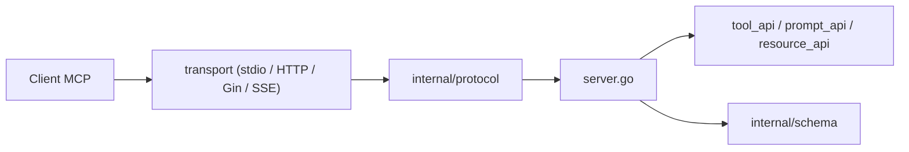

# metoro-io/mcp-golang

> Unofficial Go library for writing MCP servers and clients with typed structs.

## The problem
Writing an MCP server in Go requires protocol code, JSON schema and serialization by hand.

## What it actually does
Tool arguments are Go structs annotated with `jsonschema`; the library generates the schema, deserializes and handles errors. It exposes tools, prompts and resources (with notifications and pagination), a client, and stdio, HTTP, Gin, SSE or custom transports. HTTP/Gin are stateless: no notifications.

## How it is wired


## Trying it
```bash
go get github.com/metoro-io/mcp-golang
```
The README then provides a Go example (`NewServer`, `RegisterTool`, `Serve`) and the Claude Desktop config (`claude_desktop_config.json`).

## Cost and gotchas
Free. The HTTP transport is not bidirectional; custom HTTPS authentication is marked "in progress". Unofficial project: follows the MCP spec at its own pace.

## What it is not
Not the official protocol SDK. Not an agent framework: only the MCP server/client layer.

## Alternatives
The README cites no alternative.

## For you
Worth watching: useful only if you expose MCP tools from Go; in Python or TypeScript, the usual SDKs are more natural.
