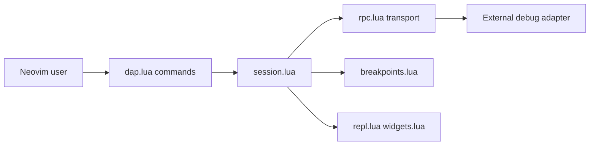

# mfussenegger/nvim-dap

> Debug Adapter Protocol client for Neovim: breakpoints, stepping, inspection for any language.

## The problem
Debug from Neovim without leaving the editor for an IDE.

## What it actually does
DAP client in Lua: launches or attaches an external adapter, handles breakpoints (conditions, logpoints, exceptions), stepping, REPL and on-demand widgets. Session (`session.lua`), asynchronous RPC transport (`rpc.lua`), entities (threads, frames, variables). Imports VS Code launch configs. Adapters must be installed yourself.

## How it is wired


## Trying it
```bash
git clone https://codeberg.org/mfussenegger/nvim-dap.git ~/.config/nvim/pack/plugins/start/nvim-dap
:DapToggleBreakpoint
:DapNew
:DapContinue
```

## Cost and gotchas
Free. One adapter per language (e.g. debugpy) must be installed and configured: outside the intended scope. Neovim 0.11 and 0.12 supported.

## What it is not
Not a standalone debugger nor an IDE-style interface: the full UI comes from extensions (nvim-dap-ui). No Vim support.

## Alternatives
vimspector (cited for Vim): same role, on the Vim side. The README does not compare other alternatives for Neovim.

## For you
Worth watching if you code Python in Neovim and want to debug scripts and pipelines; of no interest otherwise.
