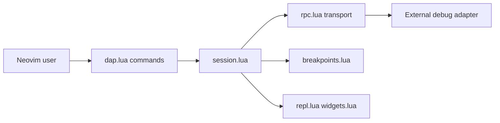

# mfussenegger/nvim-dap

> Client Debug Adapter Protocol pour Neovim : points d'arrêt, pas à pas, inspection pour tout langage.

## Le problème
Déboguer depuis Neovim sans quitter l'éditeur pour un IDE.

## Ce que ça fait vraiment
Client DAP en Lua : lance ou attache un adaptateur externe, gère points d'arrêt (conditions, logpoints, exceptions), pas à pas, REPL et widgets à la demande. Session (`session.lua`), transport RPC asynchrone (`rpc.lua`), entités (threads, frames, variables). Importe les configs de lancement VS Code. Les adaptateurs sont à installer soi-même.

## Comment c'est branché


## Essayer
```bash
git clone https://codeberg.org/mfussenegger/nvim-dap.git ~/.config/nvim/pack/plugins/start/nvim-dap
:DapToggleBreakpoint
:DapNew
:DapContinue
```

## Coût et pièges
Gratuit. Un adaptateur par langage (ex. debugpy) est à installer et configurer : hors périmètre voulu. Neovim 0.11 et 0.12 supportés.

## Ce que ce n'est pas
Pas un débogueur autonome ni une interface façon IDE : l'UI complète vient d'extensions (nvim-dap-ui). Pas de support Vim.

## Alternatives
vimspector (cité pour Vim) : même rôle, côté Vim. Le README ne compare pas d'autres alternatives pour Neovim.

## Pour toi
À surveiller si tu codes en Python sous Neovim et veux déboguer scripts et pipelines ; sans intérêt autrement.

