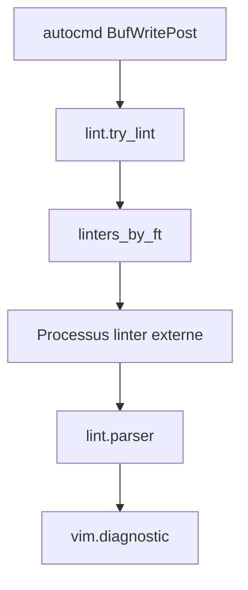

# mfussenegger/nvim-lint

> Asynchronous Neovim plugin that runs external linters and shows their results through vim.diagnostic.

## The problem
Many languages have no LSP server, or standalone linters give better results there.

## What it actually does
Runs one linter per file type (`linters_by_ft`), parses its output (parsers `from_errorformat`, `from_pattern`, `for_sarif`) and publishes Neovim diagnostics. Ships with a large number of built-in linters (ruff, mypy, hadolint, shellcheck, sqlfluff…) and lets you define your own.

## How it is wired


## Trying it
```bash
git clone \
    https://codeberg.org/mfussenegger/nvim-lint.git
    ~/.config/nvim/pack/plugins/start/nvim-lint
busted spec/
```

## Cost and gotchas
Free. Neovim ≥ 0.9.5; each linter must be installed separately. Security: some linters run a binary local to the folder (`node_modules/.bin/eslint`): do not run `try_lint()` in an untrusted repository. The main repository is on Codeberg, GitHub is only a mirror.

## What it is not
Not an LSP client nor a formatter; it does not install the linters. AI-generated contributions are refused.

## Alternatives
- ale: includes its own language server client.
- efm-langserver
- diagnostic-languageserver

## For you
Keep an eye on it: useful if you code in Neovim (ruff, mypy, sqlfluff in a single mechanism), of no interest otherwise.
