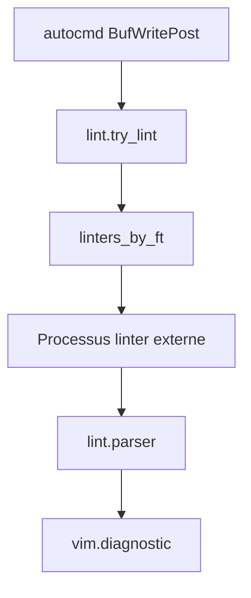

# mfussenegger/nvim-lint

> Plugin Neovim asynchrone qui lance des linters externes et affiche leurs résultats via vim.diagnostic.

## Le problème
Beaucoup de langages n'ont pas de serveur LSP, ou les linters autonomes y donnent de meilleurs résultats.

## Ce que ça fait vraiment
Lance un linter par type de fichier (`linters_by_ft`), analyse sa sortie (parseurs `from_errorformat`, `from_pattern`, `for_sarif`) et publie des diagnostics Neovim. Livré avec un grand nombre de linters intégrés (ruff, mypy, hadolint, shellcheck, sqlfluff…) et possibilité d'en définir.

## Comment c'est branché


## Essayer
```bash
git clone \
    https://codeberg.org/mfussenegger/nvim-lint.git
    ~/.config/nvim/pack/plugins/start/nvim-lint
busted spec/
```

## Coût et pièges
Gratuit. Neovim ≥ 0.9.5 ; chaque linter doit être installé séparément. Sécurité : certains linters exécutent un binaire local au dossier (`node_modules/.bin/eslint`) : ne pas lancer `try_lint()` dans un dépôt non fiable. Le dépôt principal est sur Codeberg, GitHub n'est qu'un miroir.

## Ce que ce n'est pas
Pas un client LSP ni un formateur ; il n'installe pas les linters. Contributions générées par IA refusées.

## Alternatives
- ale : inclut son propre client de serveur de langage.
- efm-langserver
- diagnostic-languageserver

## Pour toi
À surveiller : utile si tu codes en Neovim (ruff, mypy, sqlfluff en un seul mécanisme), sans intérêt sinon.

