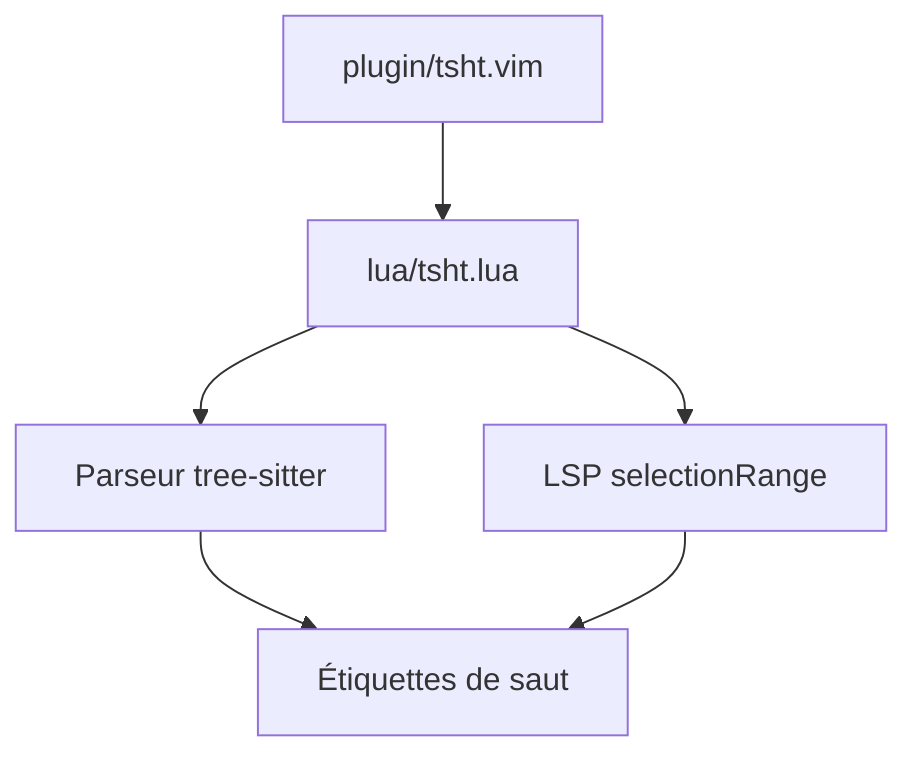

# mfussenegger/nvim-treehopper

> Neovim plugin that selects or moves the cursor onto syntax tree nodes, via labels.

## The problem
Precisely selecting a region of code by keyboard takes many keystrokes.

## What it actually does
Displays jump labels on syntax tree nodes (tree-sitter, otherwise the LSP client's `selectionRange`). Lets you select a region or move to the start or end of a node. Movement depends on hop.nvim.

## How it is wired


## Trying it
```bash
# Plugin Neovim 0.7.2+ ; avec vim-plug :
Plug mfussenegger/nvim-treehopper
# Mappings documentés :
# omap <silent> m :<C-U>lua require('tsht').nodes()<CR>
# xnoremap <silent> m :lua require('tsht').nodes()<CR>
```

## Cost and gotchas
Free. Requires a tree-sitter parser (to be compiled with `gcc` if missing) or an LSP server. GPL-3.0 license.

## What it is not
Not a code analysis tool: a selection helper for editing.

## Alternatives
hop.nvim: cited as a dependency for movement, not as a replacement.

## For you
Ignore: Neovim editing convenience, off-topic for data / AI; last push in June 2025.
