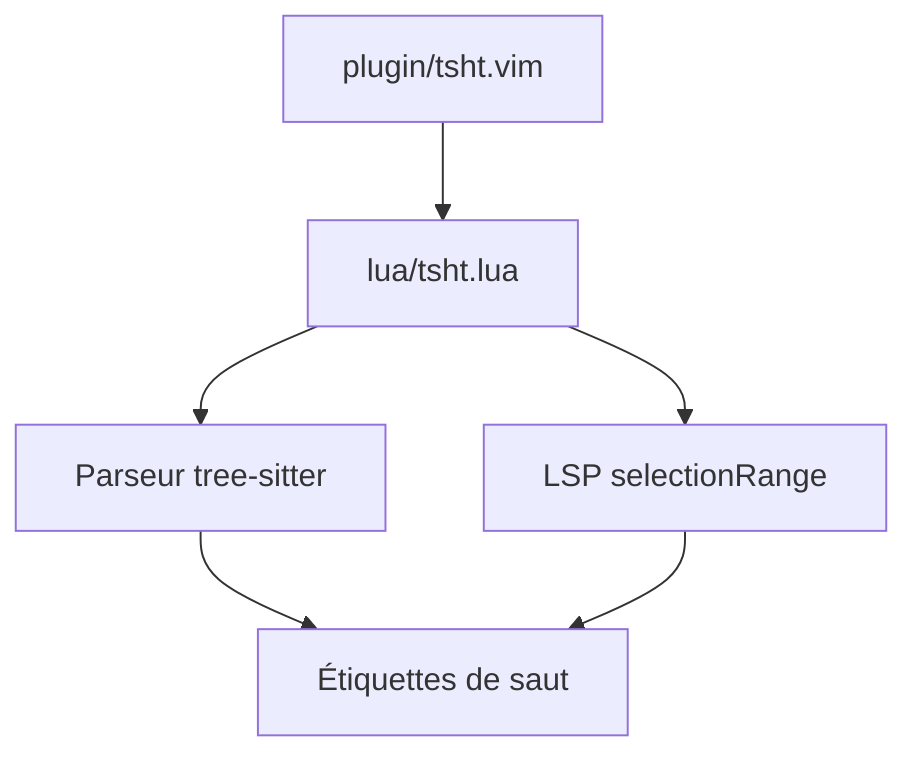

# mfussenegger/nvim-treehopper

> Plugin Neovim qui sélectionne ou déplace le curseur sur des nœuds de l'arbre syntaxique, via étiquettes.

## Le problème
Sélectionner précisément une région de code au clavier demande beaucoup de frappes.

## Ce que ça fait vraiment
Affiche des étiquettes de saut sur les nœuds de l'arbre syntaxique (tree-sitter, sinon `selectionRange` du client LSP). Permet de sélectionner une région ou de se déplacer au début ou à la fin d'un nœud. Le déplacement dépend de hop.nvim.

## Comment c'est branché


## Essayer
```bash
# Plugin Neovim 0.7.2+ ; avec vim-plug :
Plug mfussenegger/nvim-treehopper
# Mappings documentés :
# omap <silent> m :<C-U>lua require('tsht').nodes()<CR>
# xnoremap <silent> m :lua require('tsht').nodes()<CR>
```

## Coût et pièges
Gratuit. Exige un parseur tree-sitter (à compiler avec `gcc` si absent) ou un serveur LSP. Licence GPL-3.0.

## Ce que ce n'est pas
Pas un outil d'analyse de code : un aide-sélection pour l'édition.

## Alternatives
hop.nvim : cité comme dépendance pour le déplacement, non comme remplaçant.

## Pour toi
Ignorer : confort d'édition Neovim, hors sujet data / IA ; dernier push en juin 2025.

