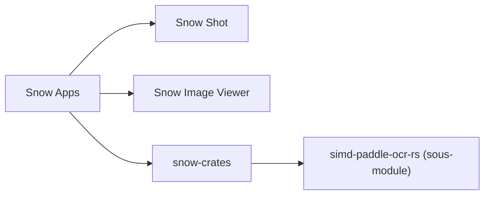

# mg-chao/snow-apps

> The same repository as snow-shot: source code of Snow Shot and Snow Image Viewer, with built-in OCR.

## The problem
Capturing a screen and then extracting its text requires several separate tools.

## What it actually does
The README is identical to that of mg-chao/snow-shot: installation via WinGet, Scoop and Homebrew, and maintenance of the `simd-paddle-ocr-rs` OCR submodule. No capture feature is described. The name "Snow Apps" designates the actual repository.

## How it is wired
Simplified diagram based on the sheet, no diagram supplied.


## Trying it
```bash
winget install --exact --id mg-chao.snow-shot --source winget
brew install --cask mg-chao/tap/snow-shot
git submodule update --init --recursive
```

## Cost and gotchas
Free. macOS 15 or later on Apple Silicon; privacy permissions possible. License present but not identified by GitHub. Apparent duplicate of mg-chao/snow-shot.

## What it is not
Not a second product: same content as snow-shot. No description of the capture features.

## Alternatives
No alternative named in the README.

## For you
Watch, like snow-shot: local OCR is interesting, but the README does not allow judging the tool.
