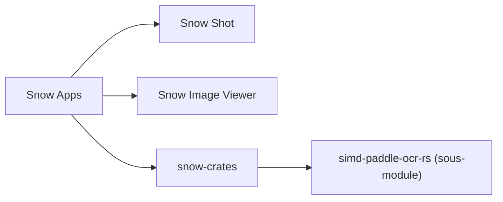

# mg-chao/snow-apps

> Le même dépôt que snow-shot : code source de Snow Shot et Snow Image Viewer, avec OCR intégré.

## Le problème
Capturer un écran puis en extraire le texte demande plusieurs outils séparés.

## Ce que ça fait vraiment
Le README est identique à celui de mg-chao/snow-shot : installation par WinGet, Scoop et Homebrew, et maintenance du sous-module OCR `simd-paddle-ocr-rs`. Aucune fonction de capture n'est décrite. Le nom « Snow Apps » désigne le dépôt réel.

## Comment c'est branché
Schéma simplifié d'après la fiche, sans diagramme fourni.


## Essayer
```bash
winget install --exact --id mg-chao.snow-shot --source winget
brew install --cask mg-chao/tap/snow-shot
git submodule update --init --recursive
```

## Coût et pièges
Gratuit. macOS 15 ou plus sur Apple Silicon ; permissions de confidentialité possibles. Licence présente mais non identifiée par GitHub. Doublon apparent de mg-chao/snow-shot.

## Ce que ce n'est pas
Pas un second produit : même contenu que snow-shot. Pas de description des fonctions de capture.

## Alternatives
Aucune alternative nommée dans le README.

## Pour toi
À surveiller, comme snow-shot : l'OCR local est intéressant, mais le README ne permet pas de juger l'outil.

