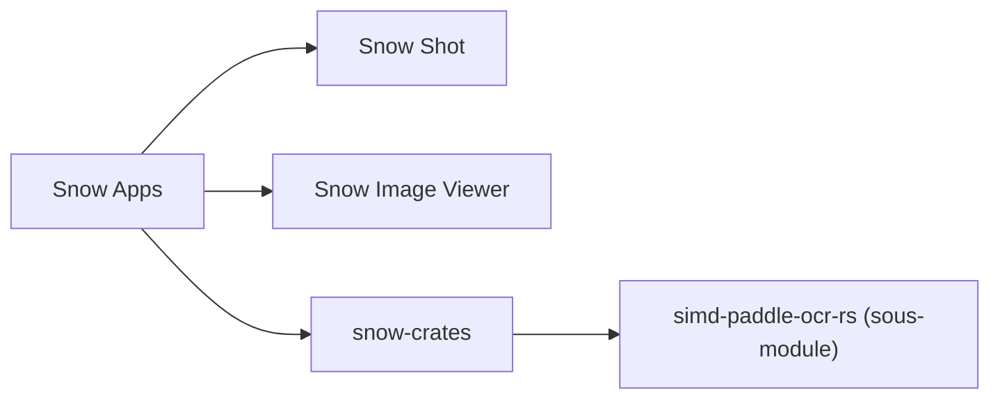

# mg-chao/snow-shot

> The source code of Snow Shot (screen capture) and Snow Image Viewer, with built-in OCR, for Windows and macOS.

## The problem
Capturing a screen and then extracting its text requires several separate tools.

## What it actually does
The repository groups the code of Snow Shot and Snow Image Viewer. The README mostly covers installation (WinGet, Scoop, Homebrew) and maintenance of the `simd-paddle-ocr-rs` OCR submodule. The capture features are not described here. There is ARM64 support on Windows.

## How it is wired
Simplified diagram based on the sheet, no diagram supplied.


## Trying it
```bash
winget install --exact --id mg-chao.snow-shot --source winget
brew install --cask mg-chao/tap/snow-shot
git submodule update --init --recursive
```

## Cost and gotchas
Free. macOS 15 or later on Apple Silicon; the macOS installation may ask for keychain access and privacy permissions. License present but not identified by GitHub. Same content as mg-chao/snow-apps.

## What it is not
Not a presentation of the capture features: the README does not describe them. Not an OCR library to integrate as is.

## Alternatives
No alternative named in the README.

## For you
Watch: local OCR could be used to extract text from images, but the actual features remain undocumented here.
