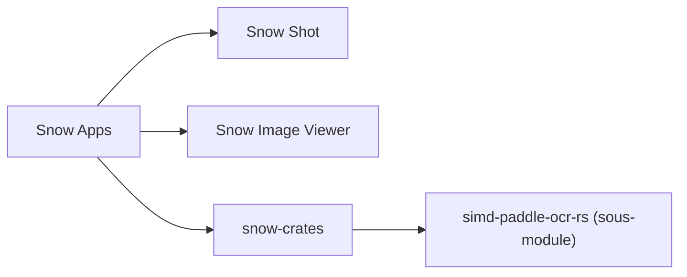

# mg-chao/snow-shot

> Le code source de Snow Shot (capture d'écran) et Snow Image Viewer, avec OCR intégré, pour Windows et macOS.

## Le problème
Capturer un écran puis en extraire le texte demande plusieurs outils séparés.

## Ce que ça fait vraiment
Le dépôt regroupe le code de Snow Shot et de Snow Image Viewer. Le README parle surtout d'installation (WinGet, Scoop, Homebrew) et de maintenance du sous-module OCR `simd-paddle-ocr-rs`. Les fonctions de capture ne sont pas décrites ici. Il existe une prise en charge ARM64 sous Windows.

## Comment c'est branché
Schéma simplifié d'après la fiche, sans diagramme fourni.


## Essayer
```bash
winget install --exact --id mg-chao.snow-shot --source winget
brew install --cask mg-chao/tap/snow-shot
git submodule update --init --recursive
```

## Coût et pièges
Gratuit. macOS 15 ou plus sur Apple Silicon ; l'installation macOS peut demander un accès au trousseau et des permissions de confidentialité. Licence présente mais non identifiée par GitHub. Même contenu que mg-chao/snow-apps.

## Ce que ce n'est pas
Pas une présentation des fonctions de capture : le README ne les décrit pas. Pas une bibliothèque OCR à intégrer telle quelle.

## Alternatives
Aucune alternative nommée dans le README.

## Pour toi
À surveiller : l'OCR local peut servir à extraire du texte d'images, mais les fonctions réelles restent non documentées ici.

