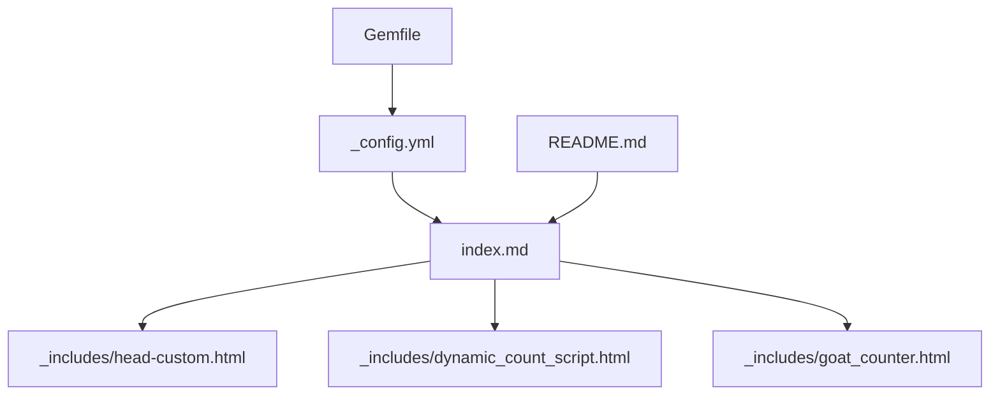

# mgaudet/CompilerJobs

> List of companies hiring in compilers, languages and runtimes, for anyone looking for a job in this field.

## The problem
Compiler teams are scattered and hard to spot in general job listings.

## What it actually does
An index.md file published by Jekyll with hundreds of companies, annotated by remote work, internships and location, and by domain: LLVM, JVM, AI accelerators, static analysis, quantum compilation. The author wants evidence of past or upcoming hiring.

## How it is wired

## Trying it
No command documented: it is a page to read.

## Cost and gotchas
Free. No license declared. The list is not exhaustive; locations are flagged as incomplete. A GoatCounter counter is included in the site.

## What it is not
Not a list of active job postings: it points to teams, not open positions.

## Alternatives
No alternative cited in the README.

## For you
Ignore: only useful if you are aiming for an ML compilation job (MLIR, TVM, Triton); the list cites several.
