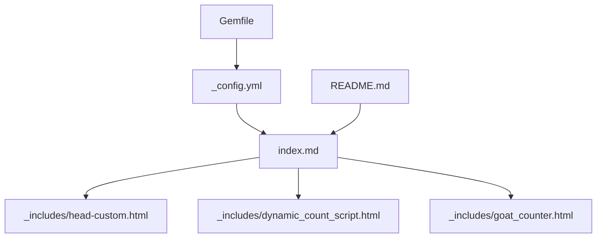

# mgaudet/CompilerJobs

> Liste d'entreprises qui recrutent en compilateurs, langages et runtimes, pour qui cherche un poste dans ce domaine.

## Le problème
Les équipes de compilateurs sont dispersées et peu visibles dans les offres d'emploi généralistes.

## Ce que ça fait vraiment
Un fichier index.md publié par Jekyll avec des centaines d'entreprises, annotées par télétravail, stages et lieu, et par domaine : LLVM, JVM, accélérateurs d'IA, analyse statique, compilation quantique. L'auteur veut des preuves d'embauche passée ou à venir.

## Comment c'est branché

## Essayer
Aucune commande documentée : c'est une page à lire.

## Coût et pièges
Gratuit. Aucune licence déclarée. La liste n'est pas exhaustive ; les lieux sont signalés comme incomplets. Un compteur GoatCounter est inclus dans le site.

## Ce que ce n'est pas
Pas une liste d'offres d'emploi actives : elle indique des équipes, pas des postes ouverts.

## Alternatives
Aucune alternative citée dans le README.

## Pour toi
Ignorer : utile seulement si tu vises un poste en compilation ML (MLIR, TVM, Triton) ; la liste en cite plusieurs.

