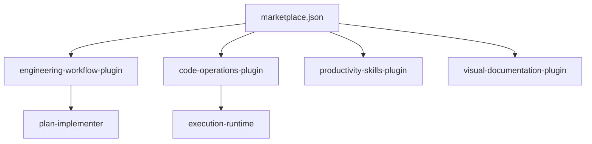

# mhattingpete/claude-skills-marketplace

> Claude Code plugin marketplace: planning, git, test fixing, refactoring and visual documentation.

## The problem
Repetitive engineering tasks (planning, committing, fixing tests) are redone by hand in every session.

## What it actually does
Four skill plugins and a `plan-implementer` agent. An "execution-runtime" runs Python locally to limit tokens on bulk operations; the announced gain (90 to 99%) comes from the README and is not verified here. Skills for planning, git-pushing, test-fixing, code-refactor and HTML diagram generation.

## How it is wired


## Trying it
```bash
/plugin marketplace add mhattingpete/claude-skills-marketplace
~/.claude/plugins/marketplaces/mhattingpete-claude-skills/execution-runtime/setup.sh
```

## Cost and gotchas
Free, but the skills consume your Claude tokens. The agent mentions the claude-3-5-haiku model, which is old. Last push in July 2026: read `setup.sh` before running it.

## What it is not
Not a stabilized product: the skills are generic, to be adapted to your workflows, according to the author.

## Alternatives
No alternative cited in the README. It points to Anthropic's official skills.

## For you
Worth watching: a few generic skills to pick from, but nothing essential compared with the official skills.
