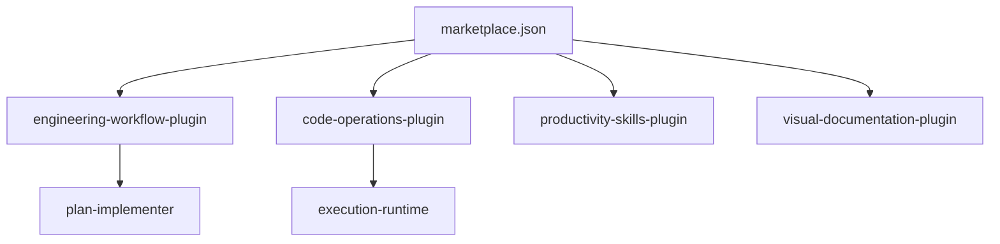

# mhattingpete/claude-skills-marketplace

> Place de marché de plugins Claude Code : planification, git, correction de tests, refactoring et documentation visuelle.

## Le problème
Les tâches répétitives d'ingénierie (planifier, committer, corriger des tests) se refont à la main à chaque session.

## Ce que ça fait vraiment
Quatre plugins de skills et un agent `plan-implementer`. Un « execution-runtime » exécute du Python en local pour limiter les tokens sur les opérations en masse ; le gain annoncé (90 à 99 %) vient du README et n'est pas vérifié ici. Skills de planification, git-pushing, test-fixing, code-refactor et génération de diagrammes HTML.

## Comment c'est branché


## Essayer
```bash
/plugin marketplace add mhattingpete/claude-skills-marketplace
~/.claude/plugins/marketplaces/mhattingpete-claude-skills/execution-runtime/setup.sh
```

## Coût et pièges
Gratuit, mais les skills consomment tes tokens Claude. L'agent mentionne le modèle claude-3-5-haiku, ancien. Dernier push en juillet 2026 : relire `setup.sh` avant de l'exécuter.

## Ce que ce n'est pas
Pas un produit stabilisé : les skills sont génériques, à adapter à tes workflows, selon l'auteur.

## Alternatives
Aucune alternative citée dans le README. Il renvoie aux skills officiels d'Anthropic.

## Pour toi
À surveiller : quelques skills génériques à piocher, mais rien d'indispensable face aux skills officiels.

