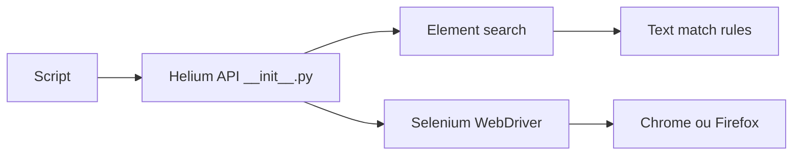

# mherrmann/helium

> Python wrapper around Selenium to automate Chrome and Firefox using visible labels.

## The problem
Selenium imposes fragile IDs, XPath and CSS, manual waits and frame switching.

## What it actually does
Adds a high-level API: elements are designated by their text (`Button('Download')`). Handles nested iframes without "switching", popup windows, the implicit 10 s wait and `wait_until`. You can mix Helium and Selenium on the same driver.

## How it is wired


## Trying it
```bash
python -m pip install helium
```
```python
driver = start_chrome()
wait_until(Button('Download').exists)
```

## Cost and gotchas
Free; Chrome or Firefox required. The author rarely answers issues and does not maintain it for free, but accepts PRs.

## What it is not
Not a new engine: everything goes through Selenium. Internet Explorer and Java are no longer supported.

## Alternatives
No alternative named in the README (raw Selenium compared).

## For you
Worth watching: handy for scraping or quick tests, but a very part-time maintainer is a risk over the long run.
