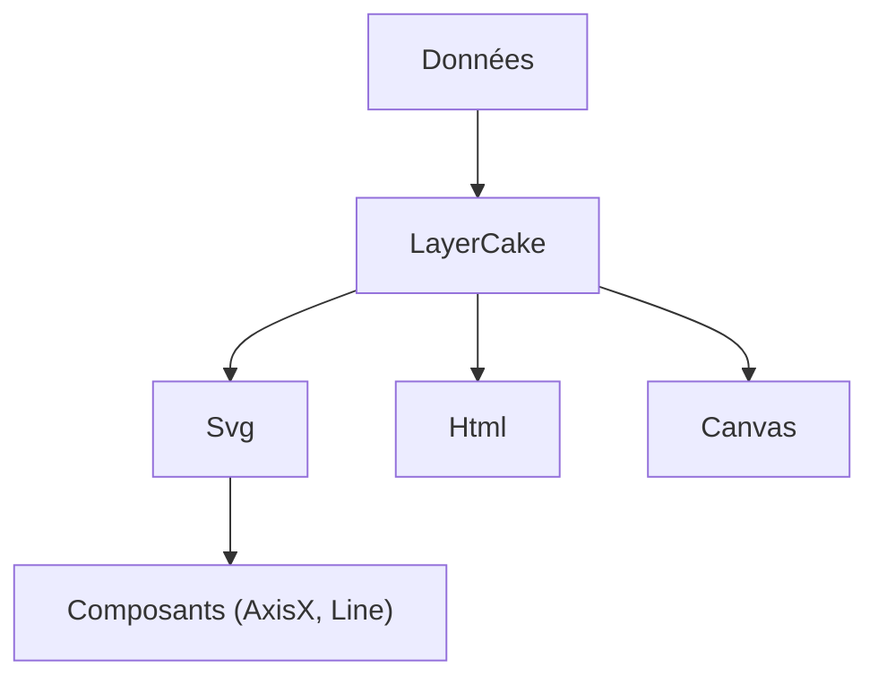

# mhkeller/layercake

> Headless visualization framework for Svelte, meant for building reusable graphics.

## The problem
Chart libraries impose their own shapes; assembling custom charts in Svelte means handling scales and dimensions by hand.

## What it actually does
A `LayerCake` component manages data, scales and dimensions, and provides empty layers (`Svg`, `Html`, `Canvas`). You fill them with your own chart components (axes, lines, scatter plots, labels) copied from the gallery. Since version 11, the library uses Svelte runes.

## How it is wired
Simplified diagram based on the sheet, no diagram provided.



## Trying it
```sh
npm install --save layercake
```

## Cost and gotchas
Free. You need a Svelte application, and the chart components are yours to write or copy. The move from version 10 to 11 changes the API (runes instead of stores).

## What it is not
Not a catalogue of ready-made charts. Not usable without Svelte.

## Alternatives
No alternative named in the README.

## For you
Worth watching: useful if you build data dashboards in Svelte with custom charts, of no interest outside that ecosystem.
