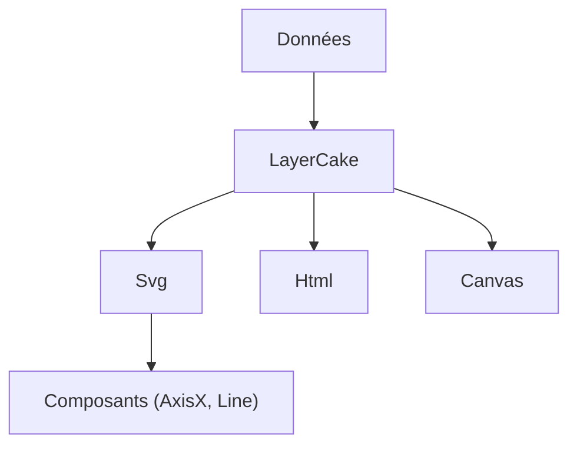

# mhkeller/layercake

> Cadre de visualisation sans en-tête pour Svelte, destiné à construire des graphiques réutilisables.

## Le problème
Les bibliothèques de graphiques imposent leurs formes ; assembler des graphiques sur mesure en Svelte demande de gérer échelles et dimensions à la main.

## Ce que ça fait vraiment
Un composant `LayerCake` gère données, échelles et dimensions, et fournit des couches vides (`Svg`, `Html`, `Canvas`). Tu les remplis avec tes propres composants de graphique (axes, lignes, nuages de points, étiquettes) copiés depuis la galerie. Depuis la version 11, la bibliothèque utilise les runes de Svelte.

## Comment c'est branché
Schéma simplifié d'après la fiche, sans diagramme fourni.



## Essayer
```sh
npm install --save layercake
```

## Coût et pièges
Gratuit. Il faut une application Svelte, et les composants de graphique sont à écrire ou copier toi-même. Le passage de la version 10 à la 11 change l'API (runes au lieu des stores).

## Ce que ce n'est pas
Ce n'est pas un catalogue de graphiques prêts à l'emploi. Ce n'est pas utilisable sans Svelte.

## Alternatives
Aucune alternative nommée dans le README.

## Pour toi
À surveiller : utile si tu construis des tableaux de bord de données en Svelte avec des graphiques sur mesure, sans intérêt hors de cet écosystème.

