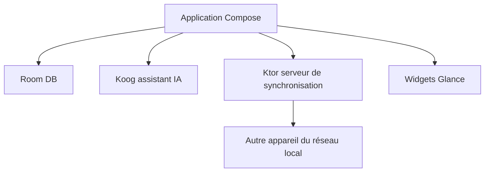

# mhss1/MyBrain

> A local Android productivity app: tasks, notes, calendar, journal, bookmarks and an AI assistant.

## The problem
Tasks, notes and bookmarks are scattered across separate apps that often send their data to the cloud.

## What it actually does
An Android app in Kotlin Multiplatform and Compose: tasks with subtasks and reminders, markdown notes, daily mood with charts, bookmarks via the share menu, a calendar with widget, a dashboard. An AI assistant can create and retrieve items. Encrypted local sync (AES-GCM) between devices on the same network, with no data collection according to the README.

## How it is wired
Simplified diagram based on the sheet, no diagram provided.

## Trying it
No command documented: the README points to Obtainium and the GitHub releases to install the APK.

## Cost and gotchas
Free. Removal from F-Droid announced: you must export your data and install from GitHub. The README does not say which model powers the assistant nor its possible cost.

## What it is not
Not a cross-platform app for now: only the Android target exists. No cloud backup, sync remains local.

## Alternatives
No alternative named in the README.

## For you
Ignore: a personal productivity app for Android, unrelated to your data, AI or MLOps work.
