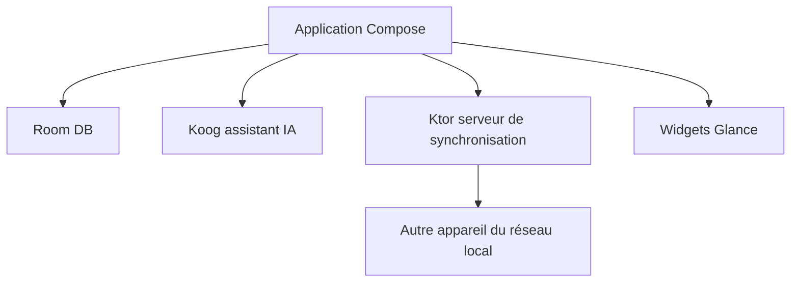

# mhss1/MyBrain

> Une application Android de productivité locale : tâches, notes, agenda, journal, signets et assistant IA.

## Le problème
Tâches, notes et signets sont éparpillés dans des applications distinctes qui envoient souvent leurs données dans le cloud.

## Ce que ça fait vraiment
Application Android en Kotlin Multiplatform et Compose : tâches avec sous-tâches et rappels, notes en markdown, humeur quotidienne avec graphiques, signets via le menu de partage, agenda avec widget, tableau de bord. Un assistant IA peut créer et retrouver des éléments. Synchronisation locale chiffrée (AES-GCM) entre appareils du même réseau, sans collecte de données selon le README.

## Comment c'est branché
Schéma simplifié d'après la fiche, sans diagramme fourni.

## Essayer
Aucune commande documentée : le README renvoie à Obtainium et aux releases GitHub pour installer l'APK.

## Coût et pièges
Gratuit. Retrait de F-Droid annoncé : il faut exporter ses données et installer depuis GitHub. Le README ne dit pas quel modèle sert l'assistant ni son éventuel coût.

## Ce que ce n'est pas
Pas une application multiplateforme pour l'instant : seule la cible Android existe. Pas de sauvegarde cloud, la synchronisation reste locale.

## Alternatives
Aucune alternative nommée dans le README.

## Pour toi
À ignorer : application de productivité personnelle pour Android, sans rapport avec ton travail data, IA ou MLOps.

