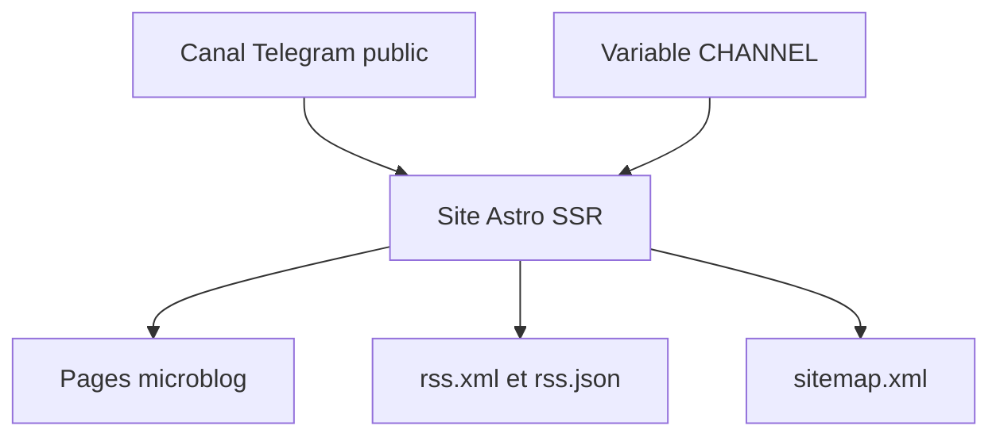

# miantiao-me/BroadcastChannel

> Turns a public Telegram channel into a static microblog with RSS, for people who publish on Telegram.

## The problem
A Telegram channel is neither indexed by search engines nor easy to follow via RSS.

## What it actually does
An Astro site that reads the public channel's messages, with no browser-side JavaScript. It provides a sitemap, RSS and JSON RSS feeds, about ten CSS themes, and deploys to Cloudflare Workers, Netlify, Vercel or Docker.

## How it is wired
Simplified diagram based on the sheet, no diagram supplied.



## Trying it
```bash
docker pull ghcr.io/miantiao-me/broadcastchannel:main
docker run -d --name broadcastchannel -p 4321:4321 -e CHANNEL=miantiao_me ghcr.io/miantiao-me/broadcastchannel:main
```

## Cost and gotchas
Free, but the channel must be public and depends on Telegram. Cloudflare Pages SSR is not supported, you need Workers.

## What it is not
Not a general CMS: the only source is Telegram. AGPL-3.0 license.

## Alternatives
No alternative named in the README.

## For you
Ignore: no use for data or MLOps work, unless you already publish on Telegram.
