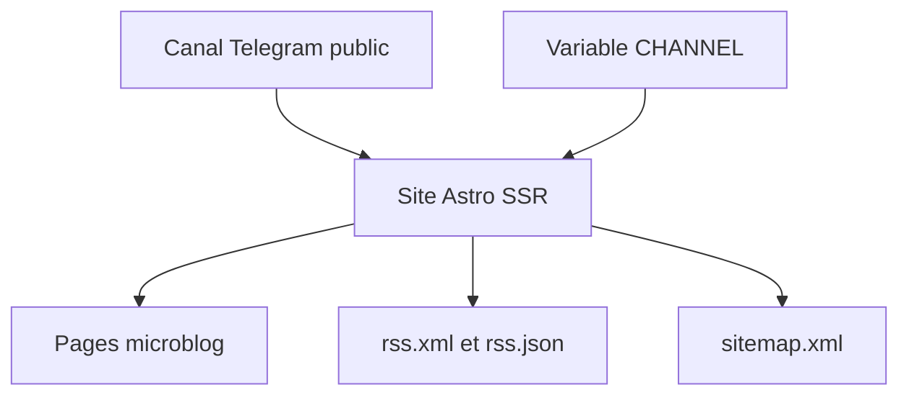

# miantiao-me/BroadcastChannel

> Transforme un canal Telegram public en microblog statique avec RSS, pour qui publie sur Telegram.

## Le problème
Un canal Telegram n'est ni indexé par les moteurs de recherche ni facile à suivre par RSS.

## Ce que ça fait vraiment
Un site Astro qui lit les messages du canal public, sans JavaScript côté navigateur. Il fournit sitemap, flux RSS et RSS JSON, une dizaine de thèmes CSS et se déploie sur Cloudflare Workers, Netlify, Vercel ou Docker.

## Comment c'est branché
Schéma simplifié d'après la fiche, sans diagramme fourni.



## Essayer
```bash
docker pull ghcr.io/miantiao-me/broadcastchannel:main
docker run -d --name broadcastchannel -p 4321:4321 -e CHANNEL=miantiao_me ghcr.io/miantiao-me/broadcastchannel:main
```

## Coût et pièges
Gratuit, mais le canal doit être public et dépend de Telegram. Cloudflare Pages SSR n'est pas supporté, il faut Workers.

## Ce que ce n'est pas
Pas un CMS général : la source est uniquement Telegram. Licence AGPL-3.0.

## Alternatives
Aucune alternative nommée dans le README.

## Pour toi
À ignorer : aucune utilité pour un travail data ou MLOps, sauf si tu publies déjà sur Telegram.

