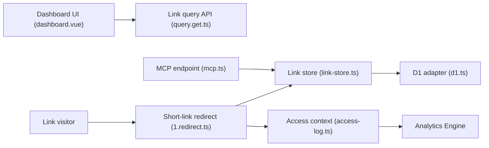

# miantiao-me/Sink

> Link shortener with statistics, hosted entirely on Cloudflare, for individuals and small teams.

## The problem
Public shorteners impose their limits and their data; hosting one the classic way requires a server and a database.

## What it actually does
- Shortens URLs with custom slug, expiry, password, dangerous-link warning, redirection by device or country.
- Access statistics via Workers Analytics Engine, 3D globe and event log (polled every 10 s).
- Optional generation of slugs and OpenGraph metadata by Cloudflare Workers AI.
- Built-in MCP endpoint (`POST /api/mcp`), JSON and CSV import/export, QR codes.

## How it is wired


## Trying it
Deployment points to the documentation and a video, with no command in the README. The only command present, for the AI skills:
```bash
npx skills add miantiao-me/sink
```

## Cost and gotchas
Cloudflare account required (Workers, D1, KV, Analytics Engine, optional R2); the bill depends on your Cloudflare plan. Cloudflare Pages is deprecated, Workers recommended. The site token protects the dashboard and the API: change it.

## What it is not
- Not portable: it is tied to Cloudflare; the Slite variant (Node.js/Docker) exists for local self-hosting.
- Not a multi-user offering nor one with an SLA: the README points to S.EE for that.
- AGPL-3.0: modified hosting obliges you to publish the code.

## Alternatives
- Slite: same project, runs on Node.js 24+/Docker, outside Cloudflare.
- S.EE: managed service for professional needs.

## For you
Worth watching: handy for tracked links if you are already on Cloudflare, but unrelated to the data/AI core, other than through its MCP server.
