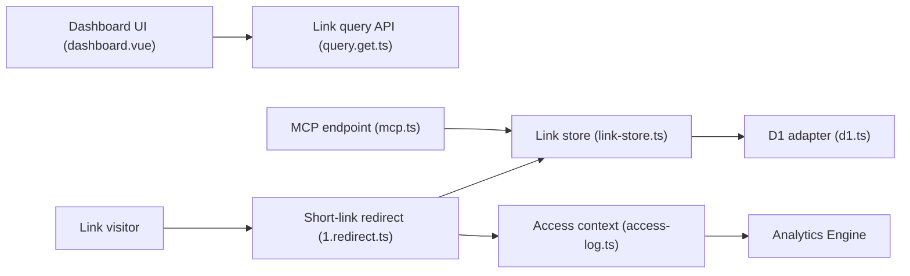

# miantiao-me/Sink

> Raccourcisseur de liens avec statistiques, hébergé entièrement sur Cloudflare, pour particuliers et petites équipes.

## Le problème
Les raccourcisseurs publics imposent leurs limites et leurs données ; en héberger un classiquement demande un serveur et une base.

## Ce que ça fait vraiment
- Raccourcit des URL avec slug personnalisé, expiration, mot de passe, avertissement de lien dangereux, redirection par appareil ou pays.
- Statistiques d'accès via Workers Analytics Engine, globe 3D et journal d'événements (interrogation toutes les 10 s).
- Génération optionnelle de slugs et métadonnées OpenGraph par Cloudflare Workers AI.
- Endpoint MCP intégré (`POST /api/mcp`), import/export JSON et CSV, codes QR.

## Comment c'est branché


## Essayer
Le déploiement renvoie à la documentation et à une vidéo, sans commande dans le README. Seule commande présente, pour les compétences IA :
```bash
npx skills add miantiao-me/sink
```

## Coût et pièges
Compte Cloudflare nécessaire (Workers, D1, KV, Analytics Engine, R2 optionnel) ; la facture dépend de ton plan Cloudflare. Cloudflare Pages est déprécié, Workers recommandé. Le jeton du site protège le tableau de bord et l'API : à changer.

## Ce que ce n'est pas
- Pas portable : il est lié à Cloudflare ; la variante Slite (Node.js/Docker) existe pour l'auto-hébergement local.
- Pas une offre multi-utilisateurs ni avec SLA : le README renvoie vers S.EE pour cela.
- AGPL-3.0 : l'hébergement modifié oblige à publier le code.

## Alternatives
- Slite : même projet, tourne en Node.js 24+/Docker, hors Cloudflare.
- S.EE : service géré pour besoins professionnels.

## Pour toi
Surveiller : pratique pour des liens avec suivi si tu es déjà sur Cloudflare, mais sans rapport avec le cœur data/IA, sinon via son serveur MCP.

