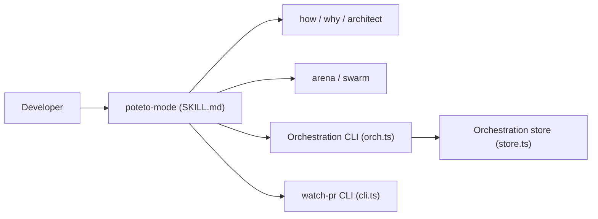

# michael-denyer/pstack-claude

> Coding-agent skill stack (derived from Lauren Tan's pstack), ported to Claude Code, Codex, Pi and Copilot.

## The problem
Coding agents deliver uneven results without a method: diagnosis, planning, verification.

## What it actually does
- `poteto-mode` takes a goal and picks a playbook among planning, feature, refactoring, performance, investigation, PR.
- Targeted skills: how, why, architect, arena, swarm, interrogate, unslop, verification.
- Routing hook at session start; `setup-pstack` sets models and reasoning levels.
- `watch-pr` CLI and durable orchestration state.
- No server and no telemetry; the content read goes to the model provider.

## How it is wired


## Trying it
```bash
/plugin marketplace add michael-denyer/pstack-claude
/plugin install pstack@pstack-claude
```
Then: "Use poteto-mode to fix the search filter resetting when I change pages."

## Cost and gotchas
Free, but the agents consume tokens from your provider; multi-agent workflows can be expensive. Copilot: tests announced on CLI 1.0.87 to 1.0.92.

## What it is not
Not an autonomous agent: instructions and scripts for existing agents.

## Alternatives
The README mentions the separate agent-formal-verify plugin for TLA+ and Lean.

## For you
Worth watching: interesting if you code a lot with agents; recent single-person project, to try on a secondary repository.
