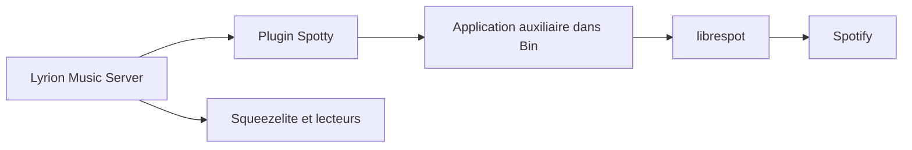

# michaelherger/Spotty-Plugin

> Spotify plugin for Lyrion Music Server, for Squeezebox and compatible players.

## The problem
Listening to Spotify on Squeezebox or Squeezelite hardware is not natively supported by Lyrion Music Server.

## What it actually does
A plugin for Lyrion Music Server that lets you play Spotify from any Squeezebox controller or the web interface. It relies on a helper application derived from librespot, shipped in its `Bin` folder. Works on Windows, macOS, Linux x86_64 and several ARM platforms.

## How it is wired

Simplified diagram based on the sheet, no diagram provided.

## Trying it
No documented command. Configuration is done in Settings/Advanced/Spotty of Lyrion Music Server.

## Cost and gotchas
Free, but you need a Spotify account and a Lyrion server. The helper application must be allowed outbound on ports 80, 443 and 4070. No license.

## What it is not
Not a product authorized by Spotify: the author writes that this use is probably prohibited, at your own risk. Unsupported platforms require compiling the helper.

## Alternatives
None named in the README (librespot is the technical base).

## For you
Unrelated to data, AI or MLOps, no license, and use contrary to Spotify's terms according to the author: ignore.
