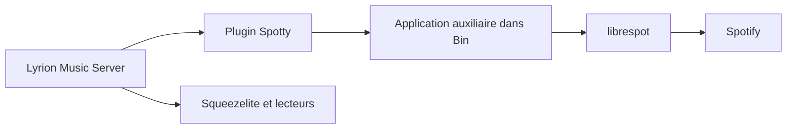

# michaelherger/Spotty-Plugin

> Greffon Spotify pour Lyrion Music Server, pour lecteurs Squeezebox et compatibles.

## Le problème
Écouter Spotify sur du matériel Squeezebox ou Squeezelite n'est pas pris en charge nativement par Lyrion Music Server.

## Ce que ça fait vraiment
Greffon pour Lyrion Music Server qui permet de lire Spotify depuis n'importe quel contrôleur Squeezebox ou l'interface web. Il s'appuie sur une application auxiliaire dérivée de librespot, livrée dans son dossier `Bin`. Fonctionne sur Windows, macOS, Linux x86_64 et plusieurs plateformes ARM.

## Comment c'est branché

Schéma simplifié d'après la fiche, sans diagramme fourni.

## Essayer
Aucune commande documentée. La configuration se fait dans Settings/Advanced/Spotty de Lyrion Music Server.

## Coût et pièges
Gratuit, mais il faut un compte Spotify et un serveur Lyrion. Il faut autoriser l'application auxiliaire à sortir sur les ports 80, 443 et 4070. Licence absente.

## Ce que ce n'est pas
Pas un produit autorisé par Spotify : l'auteur écrit que cet usage est probablement interdit, à tes risques. Les plateformes non prises en charge demandent de compiler l'auxiliaire.

## Alternatives
Aucune nommée dans le README (librespot est la base technique).

## Pour toi
Sans rapport avec data, IA ou MLOps, licence absente et usage contraire aux conditions de Spotify selon l'auteur : à ignorer.

