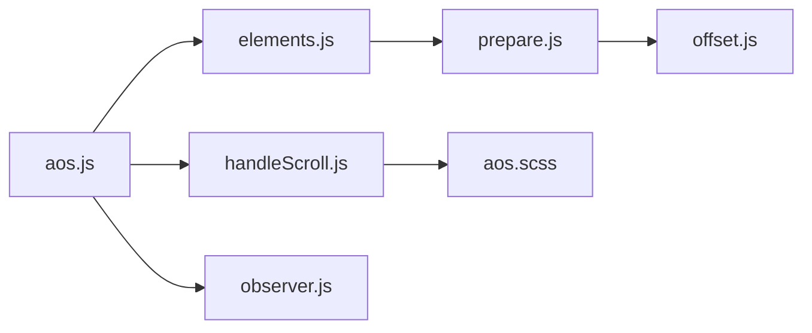

# michalsnik/aos

> Library that triggers CSS animations as the page scrolls, for web integrators.

## The problem
Animating elements as they appear on scroll without writing JavaScript for each one.

## What it actually does
You add a `data-aos` attribute to an element; AOS computes its position, then applies an animation class on scroll and emits `aos:in` and `aos:out` events. Settings via `data-aos-*` attributes (delay, duration, easing, anchor); DOM mutations are detected. This README covers the aos@next branch; v2 lives elsewhere.

## How it is wired


## Trying it
```bash
npm install --save aos@next
```
```js
import AOS from 'aos';
import 'aos/dist/aos.css';
AOS.init();
```

## Cost and gotchas
Free. Duration and delay are limited to 50–3000 ms in steps of 50. Without MutationObserver (IE), call `AOS.refreshHard()` manually.

## What it is not
Not a full animation engine: it triggers CSS transitions. Last push in March 2024, and the documented branch is "next".

## Alternatives
No alternative named in the README.

## For you
Watch: of no interest for data/AI work, except to dress up a demo page; little activity.
