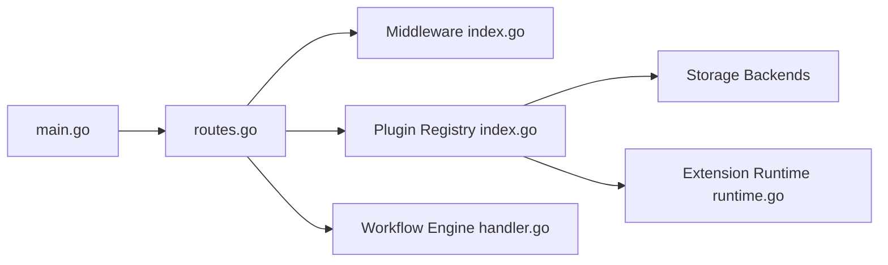

# mickael-kerjean/filestash

> Plugin-based web file manager, speaking FTP, SFTP, S3, SMB, WebDAV and about twenty other storage types.

## The problem
Accessing heterogeneous storage through a single interface, and exposing it under other protocols.

## What it actually does
Go server with a vanilla JS web client. Everything goes through plugins: storage (`IBackend`), authentication, authorization, search, file editors. Runtime plugins as zip files can embed wasm with limited network permissions. Workflow engine, shared links, gateways (S3, SFTP, MCP, AS2), SQLite full-text search.

## How it is wired

## Trying it
The README documents no install command: it points to the "Getting started" guide on the website.

## Cost and gotchas
Free when self-hosted. AGPL-3.0: publication obligations if you offer it as a modified service. The native clients and gateways are separate products.

## What it is not
Not a simple Dropbox: a plugin framework. The "AI" features (search, OCR) are described in only one line.

## Alternatives
No alternative named in the README.

## For you
Worth watching: interesting for federating storage (parquet, hdf5, netcdf readable via apps), but you need to master the AGPL and the security of multi-storage access.
