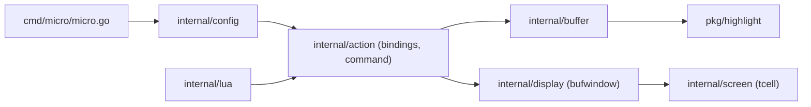

# micro-editor/micro

> Simple and intuitive terminal text editor, shipped as a single static binary.

## The problem
Editing a file over SSH forces a choice between nano, which is minimal, and vim, which is hard to pick up.

## What it actually does
Terminal editor: multiple cursors, tabs and splits, mouse support, highlighting for more than 130 languages, persistent undo, macros and Lua plugins with a built-in manager. From the code: entry point cmd/micro/micro.go, embedded configuration and resources (runtime/), text buffer internal/buffer, actions and shortcuts internal/action, tcell rendering via internal/display and screen. Shell tasks and an integrated terminal go through internal/shell.

## How it is wired


## Trying it
```bash
brew install micro
snap install micro --classic
eget micro-editor/micro
micro path/to/file.txt
ip a | micro
```

## Cost and gotchas
Free. The curl | bash script is third-party. The system clipboard requires xclip, xsel or wl-clipboard. Cygwin, Mingw and Plan9 are not supported.

## What it is not
Not an IDE. This repository is the same project as zyedidia/micro (identical README, slightly different statistics): a catalog duplicate to be merged.

## Alternatives
- nano: of which micro aims to be the successor.

## For you
To adopt: dependency-free editor for touching configuration files on remote servers and containers.
