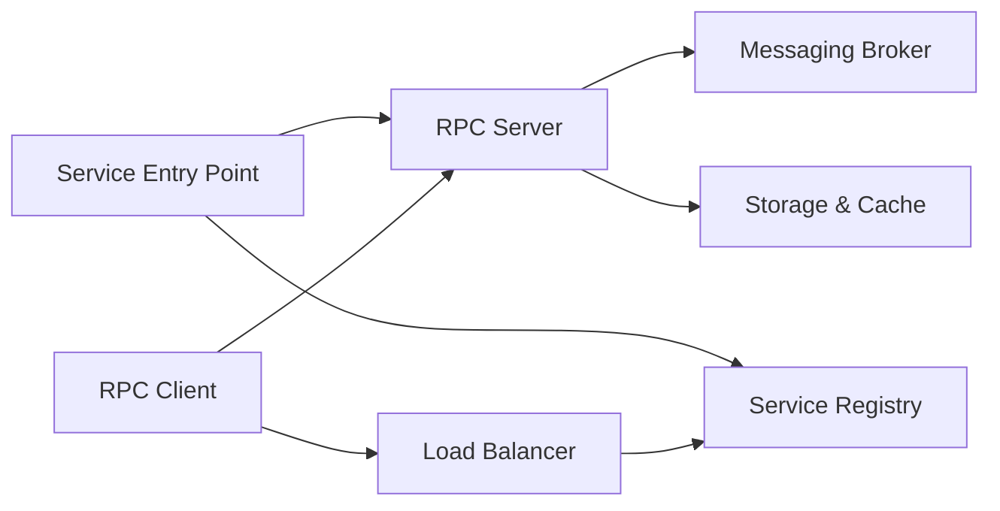

# micro/go-micro

> Go microservices framework repositioned as a "harness" for LLM agents exposed via MCP and A2A.

## The problem
Connecting an agent to real tools requires service discovery, memory, guardrails and interop protocols, often glued together by hand around an LLM loop.

## What it actually does
A service is a Go struct; its methods become REST/gRPC endpoints and MCP tools (doc comments → descriptions).
`micro.NewAgent` creates a service with an LLM: persisted memory (Postgres, NATS KV, file), `plan` and `delegate` tools, `MaxSteps`, `LoopLimit` and `ApproveTool` guardrails.
`micro run --prompt` generates Go services from a description; durable flows, mDNS/Consul/etcd registry, NATS/RabbitMQ broker.
Nine LLM providers, including Ollama locally.

## How it is wired


## Trying it
```bash
curl -fsSL https://go-micro.dev/install.sh | sh
go install go-micro.dev/v6/cmd/micro@latest
micro new helloworld
cd helloworld
micro run
```

## Cost and gotchas
Free; without a key, the "no-secret" path works with a mock model. Prompt-based generation consumes your LLM key. Commercial support offered.

## What it is not
Not a Python framework: everything is in Go. The supplied architecture describes the historical microservices framework, not the agent layer: the diagram above does not show that part. Optional x402 payments, with no built-in crypto.

## Alternatives
No alternative named in the README.

## For you
Watch: interesting idea (every tool is a service), but you work in Python, and the agent pivot is recent compared with the microservices base.
