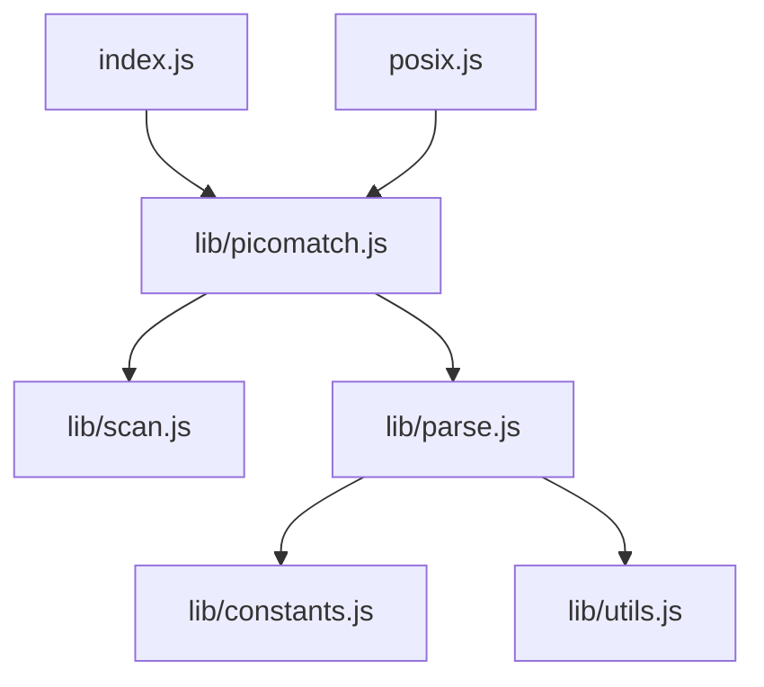

# micromatch/picomatch

> Dependency-free JavaScript library that compiles glob patterns into test functions, for Node developers.

## The problem
Comparing file paths against `*`, `**`, braces or extglobs patterns with consistent results across libraries is tedious.

## What it actually does
- `picomatch(glob, options)` returns a reusable test function for repeated calls.
- Handles braces, extglobs, POSIX brackets and Windows paths via the `windows` option.
- Exposes `parse`, `scan`, `makeRe` and `compileRe` for implementers.
- Limits input length (65536) and extglob recursion.

## How it is wired


## Trying it
```bash
npm install --save picomatch
npm install && npm test
```

## Cost and gotchas
Free, no dependencies. Brace range expansion is not included: the README points to micromatch.

## What it is not
Not a filesystem traversal tool: it compares strings. Its semantics differ from Bash 4.3 on negative extglobs.

## Alternatives
- micromatch: brace expansion, ranges and increments.
- minimatch: the main competitor compared in the README benchmarks.

## For you
Worth watching: a reliable JavaScript building block, but useful only if you write Node tools; nothing specific to data or AI.
