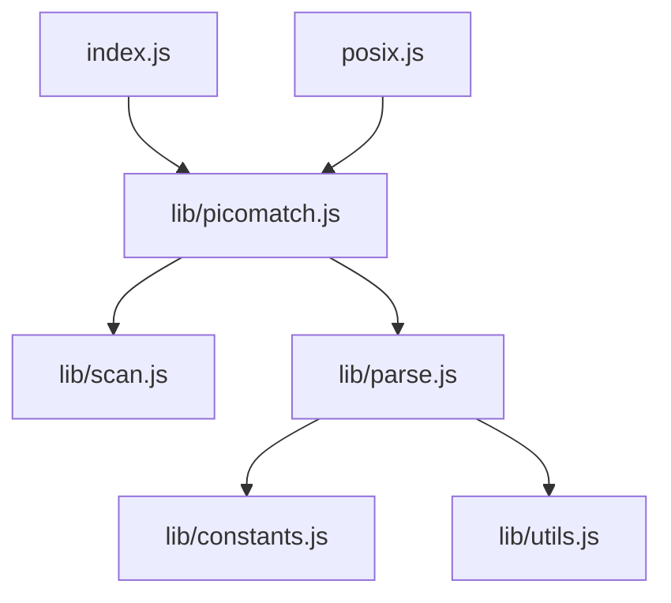

# micromatch/picomatch

> Bibliothèque JavaScript sans dépendance qui compile des motifs glob en fonctions de test, pour développeurs Node.

## Le problème
Comparer des chemins de fichiers à des motifs `*`, `**`, accolades ou extglobs avec des résultats cohérents entre bibliothèques est fastidieux.

## Ce que ça fait vraiment
- `picomatch(glob, options)` renvoie une fonction de test réutilisable pour des appels répétés.
- Gère accolades, extglobs, crochets POSIX et chemins Windows via l'option `windows`.
- Expose `parse`, `scan`, `makeRe` et `compileRe` pour les implémenteurs.
- Limite la longueur d'entrée (65536) et la récursion des extglobs.

## Comment c'est branché


## Essayer
```bash
npm install --save picomatch
npm install && npm test
```

## Coût et pièges
Gratuit, aucune dépendance. L'expansion de plages d'accolades n'est pas incluse : le README renvoie vers micromatch.

## Ce que ce n'est pas
Pas un outil de parcours du système de fichiers : il compare des chaînes. Sa sémantique diffère de Bash 4.3 sur les extglobs négatifs.

## Alternatives
- micromatch : expansion d'accolades, plages et incréments.
- minimatch : le grand concurrent comparé dans les benchmarks du README.

## Pour toi
À surveiller : brique JavaScript fiable, mais utile seulement si tu écris des outils Node ; rien de spécifique à la data ou à l'IA.

