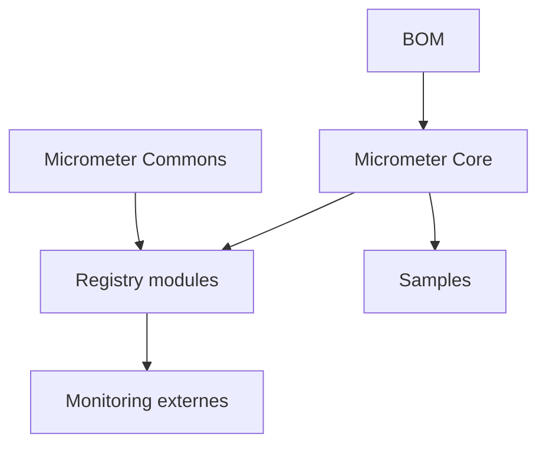

# micrometer-metrics/micrometer

> Java facade for dimensional metrics, independent of the monitoring vendor, for application developers.

## The problem
Instrumenting a Java application ties the code to a specific monitoring tool.

## What it actually does
Micrometer provides an API of counters, gauges and timers (micrometer-core, micrometer-commons). Registry modules (implementations/ folder) translate these metrics to Prometheus, Datadog, Dynatrace and others. It also handles annotations and AOP. Works with Java 8 or later, a BOM aligns the versions.

## How it is wired


## Trying it
```groovy
repositories { maven { url 'https://repo.spring.io/snapshot' } }
dependencies { implementation 'io.micrometer:micrometer-core:latest.integration' }
```

## Cost and gotchas
Free. Milestones are discouraged in production. Snapshots come from the repo.spring.io repository.

## What it is not
Not a monitoring tool: it stores and displays nothing. It is not a Python or MLOps client.

## Alternatives
No alternative named in the README.

## For you
Ignore unless you instrument Java services: in Python MLOps, it has no direct use.
