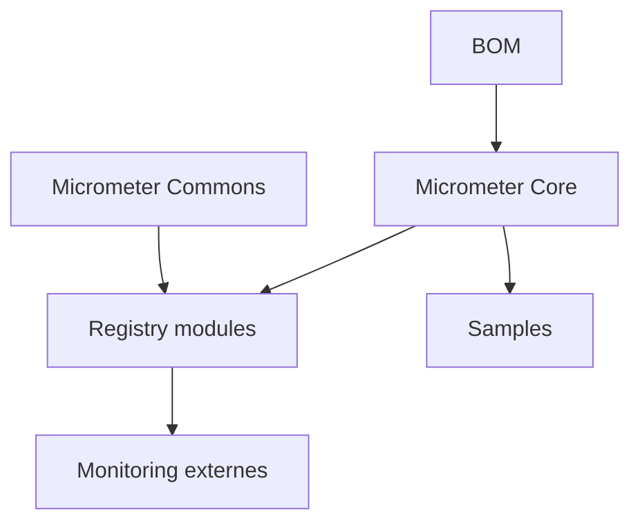

# micrometer-metrics/micrometer

> Façade Java de métriques dimensionnelles indépendante du fournisseur de supervision, pour développeurs d'applications.

## Le problème
Instrumenter une application Java lie le code à un outil de supervision précis.

## Ce que ça fait vraiment
Micrometer fournit une API de compteurs, jauges et chronomètres (micrometer-core, micrometer-commons). Des modules de registre (dossier implementations/) traduisent ces métriques vers Prometheus, Datadog, Dynatrace et d'autres. Il gère aussi des annotations et de l'AOP. Fonctionne avec Java 8 ou plus, un BOM aligne les versions.

## Comment c'est branché


## Essayer
```groovy
repositories { maven { url 'https://repo.spring.io/snapshot' } }
dependencies { implementation 'io.micrometer:micrometer-core:latest.integration' }
```

## Coût et pièges
Gratuit. Les jalons (milestones) sont déconseillés en production. Les instantanés viennent du dépôt repo.spring.io.

## Ce que ce n'est pas
Pas un outil de supervision : il ne stocke ni n'affiche rien. Ce n'est pas un client Python ou MLOps.

## Alternatives
Aucune alternative nommée dans le README.

## Pour toi
À ignorer sauf si tu instrumentes des services Java : en MLOps Python, il n'a pas d'usage direct.

