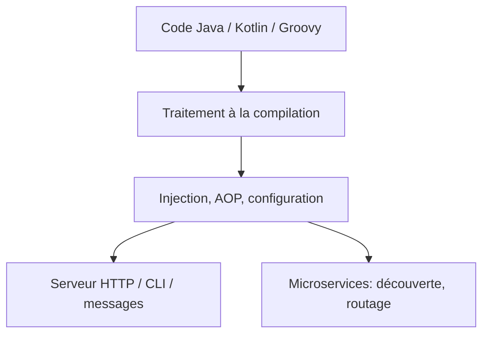

# micronaut-projects/micronaut-core

> Modular JVM framework for Java, Kotlin and Groovy applications, with fast startup and low memory use.

## The problem
Classic JVM frameworks rely on reflection and runtime bytecode generation, hence slow startup and high memory use.

## What it actually does
Computes the infrastructure at compile time: dependency injection, aspect-oriented programming, automatic configuration. Allows HTTP servers, command-line applications and message-driven applications. For microservices: distributed configuration, service discovery, HTTP routing, client-side load balancing.

## How it is wired
Simplified diagram based on the sheet, no diagram provided.



## Trying it
```bash
./gradlew publishToMavenLocal
./gradlew docs
```

## Cost and gotchas
Free. Built with Gradle. Classes marked `@Experimental` or `@Internal` are outside the versioned public API.

## What it is not
Not a data science tool. Not a Spring clone: it precisely aims to avoid its shortcomings.

## Alternatives
No alternative named in the README; it cites Spring, Spring Boot and Grails as references to improve on.

## For you
Ignore: a JVM application framework, unrelated to a data / AI / MLOps profile outside Java microservices.
