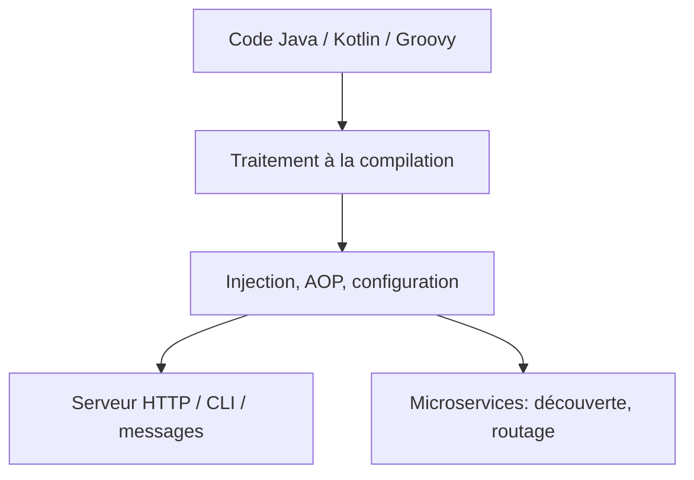

# micronaut-projects/micronaut-core

> Framework JVM modulaire pour applications Java, Kotlin et Groovy, à démarrage rapide et faible mémoire.

## Le problème
Les frameworks JVM classiques reposent sur la réflexion et la génération de bytecode à l'exécution, d'où démarrage lent et mémoire élevée.

## Ce que ça fait vraiment
Calcule l'infrastructure à la compilation : injection de dépendances, programmation orientée aspect, configuration automatique. Permet des serveurs HTTP, applications en ligne de commande et applications pilotées par messages. Pour les microservices : configuration distribuée, découverte de services, routage HTTP, équilibrage côté client.

## Comment c'est branché
Schéma simplifié d'après la fiche, sans diagramme fourni.



## Essayer
```bash
./gradlew publishToMavenLocal
./gradlew docs
```

## Coût et pièges
Gratuit. Construction avec Gradle. Les classes marquées `@Experimental` ou `@Internal` sont hors de l'API publique versionnée.

## Ce que ce n'est pas
Pas un outil de data science. Pas un clone de Spring : il vise justement à en éviter les défauts.

## Alternatives
Aucune alternative nommée dans le README ; il cite Spring, Spring Boot et Grails comme références à améliorer.

## Pour toi
À ignorer : un framework d'applications JVM, sans lien avec un profil data / IA / MLOps hors microservices Java.

