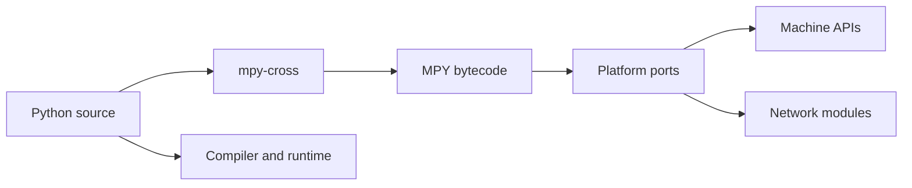

# micropython/micropython

> Python 3 implementation for microcontrollers and constrained embedded systems.

## The problem
Programming boards with very little memory (16 KiB of RAM) without switching to C.

## What it actually does
Python core (`py/`), `mpy-cross` cross-compiler that produces `.mpy` bytecode, and more than twenty ports (esp32, rp2, stm32, unix…) in three support tiers. Hardware modules (GPIO, SPI, I2C, CAN, Bluetooth, USB) and a subset of the standard library.

## How it is wired


## Trying it
```bash
cd mpy-cross
make
cd ports/name
make submodules
```

## Cost and gotchas
A compatible board is required (256 KiB of flash and 16 KiB of RAM at minimum, 512/128 recommended), `make`, gcc, Python 3.3+; CMake for rp2 and esp32.

## What it is not
Not a full Python: only a subset of the 3.4 syntax and of the modules. No NumPy nor data ecosystem.

## Alternatives
None named in the README.

## For you
Ignore: it is embedded work; only worth a look if you do AI on microcontrollers. License present but not identified by GitHub, while the README says MIT.
