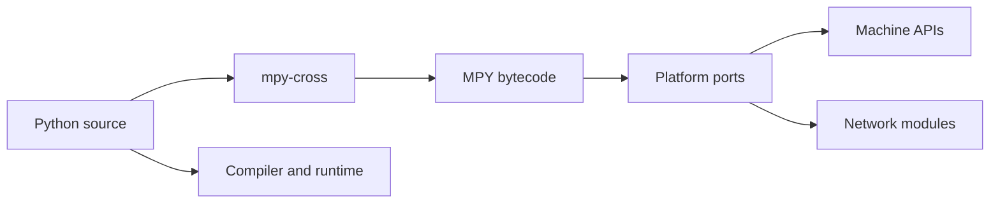

# micropython/micropython

> Implémentation de Python 3 pour microcontrôleurs et systèmes embarqués contraints.

## Le problème
Programmer des cartes avec très peu de mémoire (16 Kio de RAM) sans passer au C.

## Ce que ça fait vraiment
Noyau Python (`py/`), compilateur croisé `mpy-cross` qui produit du bytecode `.mpy`, et plus de vingt ports (esp32, rp2, stm32, unix…) en trois niveaux de support. Modules matériels (GPIO, SPI, I2C, CAN, Bluetooth, USB) et sous-ensemble de la bibliothèque standard.

## Comment c'est branché


## Essayer
```bash
cd mpy-cross
make
cd ports/name
make submodules
```

## Coût et pièges
Carte compatible requise (256 Kio de flash et 16 Kio de RAM au minimum, 512/128 recommandés), `make`, gcc, Python 3.3+ ; CMake pour rp2 et esp32.

## Ce que ce n'est pas
Pas un Python complet : seulement un sous-ensemble de la syntaxe 3.4 et des modules. Pas de NumPy ni d'écosystème data.

## Alternatives
Aucune nommée dans le README.

## Pour toi
Ignorer : c'est de l'embarqué ; à regarder seulement si tu fais de l'IA sur microcontrôleur. Licence présente mais non identifiée par GitHub, alors que le README dit MIT.

