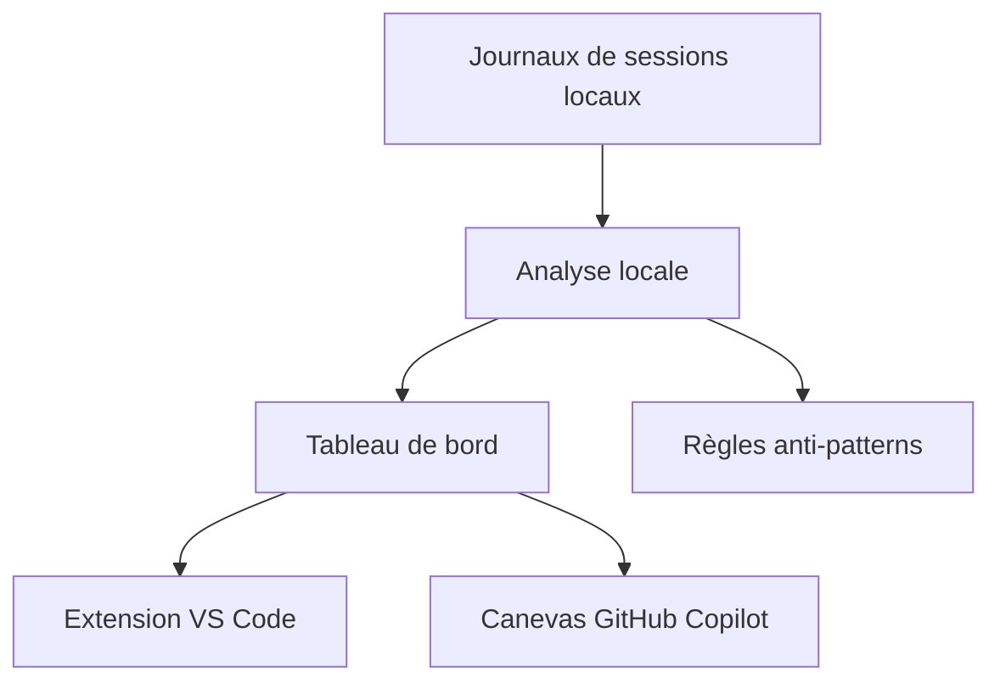

# microsoft/AI-Engineering-Coach

> VS Code extension that analyzes your coding assistant session logs to help you use them better.

## The problem
People use coding assistants without measuring their habits: poor prompts, badly managed sessions, thin context.

## What it actually does
Reads the session logs of several assistants locally and displays a dashboard: practice scores, timeline, volume of generated code, 45 editable anti-pattern rules, detection of repeated prompts to turn into skills, context health. Also runs as a canvas in the GitHub Copilot application. Local, read-only analysis.

## How it is wired
Simplified diagram based on the write-up, no diagram provided.



## Trying it
```bash
git clone https://github.com/microsoft/ai-engineering-coach.git
cd ai-engineering-coach
npm ci
npm run package
code --install-extension ai-engineer-coach-*.vsix
```

## Cost and gotchas
Free, but not published on a marketplace: you must build the `.vsix`. Some AI features require GitHub Copilot; they are hidden in canvas mode. The Burndown pages and the token detail are disabled.

## What it is not
It is not an official Microsoft product: it is a community effort by employees, with no guarantee. Per-ticket credits are rough estimates, not usable for billing.

## Alternatives
No alternative named in the README.

## For you
Worth watching: useful to objectively measure your use of coding assistants without sending anything outside, but the project is recent and must be built yourself.
