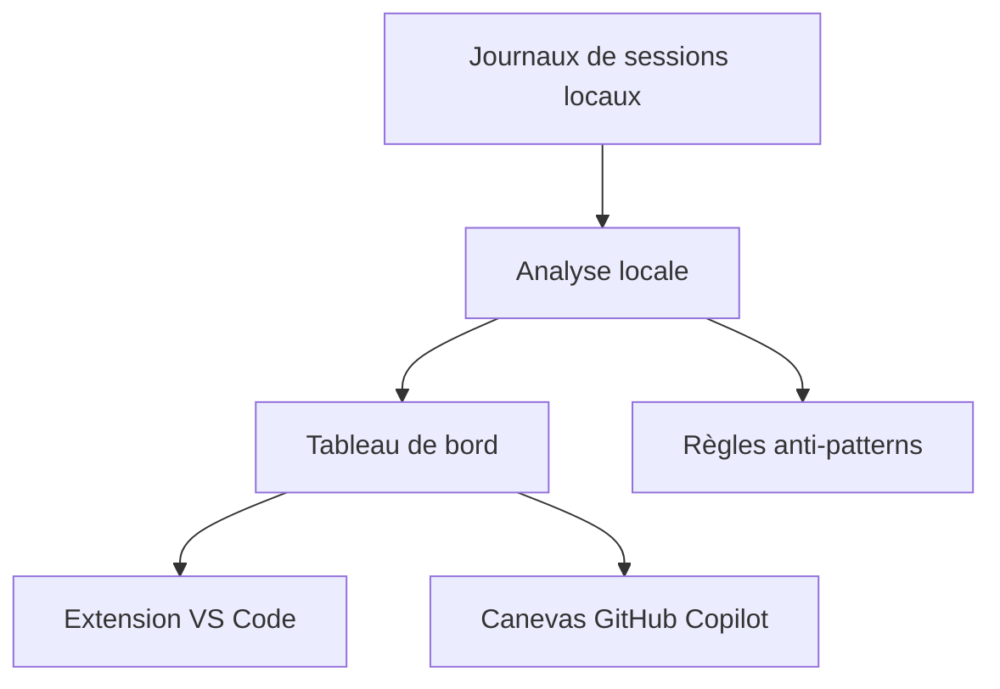

# microsoft/AI-Engineering-Coach

> Extension VS Code qui analyse tes journaux de sessions d'assistants de code pour t'aider à mieux les utiliser.

## Le problème
On utilise des assistants de code sans mesurer ses habitudes : mauvais prompts, sessions mal tenues, contexte pauvre.

## Ce que ça fait vraiment
Lit en local les journaux de sessions de plusieurs assistants et affiche un tableau de bord : scores de pratique, chronologie, volume de code généré, 45 règles d'anti-motifs modifiables, recherche de prompts répétés à transformer en skills, santé du contexte. Tourne aussi comme canevas dans l'application GitHub Copilot. Analyse locale, lecture seule.

## Comment c'est branché
Schéma simplifié d'après la fiche, sans diagramme fourni.



## Essayer
```bash
git clone https://github.com/microsoft/ai-engineering-coach.git
cd ai-engineering-coach
npm ci
npm run package
code --install-extension ai-engineer-coach-*.vsix
```

## Coût et pièges
Gratuit, mais non publié sur une place de marché : il faut compiler le `.vsix`. Certaines fonctions IA exigent GitHub Copilot ; elles sont masquées en mode canevas. Les pages Burndown et le détail des tokens sont désactivés.

## Ce que ce n'est pas
Ce n'est pas un produit officiel Microsoft : c'est un effort communautaire d'employés, sans garantie. Les crédits par ticket sont des estimations approximatives, non utilisables pour la facturation.

## Alternatives
Aucune alternative nommée dans le README.

## Pour toi
Surveiller : utile pour objectiver ton usage d'assistants de code sans rien envoyer à l'extérieur, mais le projet est récent et à compiler soi-même.

