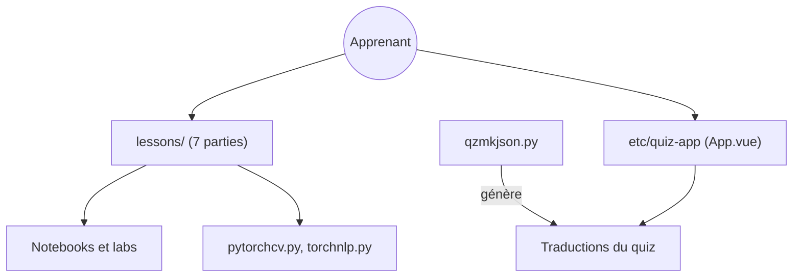

# microsoft/AI-For-Beginners

> A 12-week, 24-lesson AI course with notebooks and quizzes, for beginners.

## The problem
Beginners don't know where to start among symbolic AI, neural networks, vision and language.

## What it actually does
A seven-part curriculum: introduction, symbolic AI, neural networks, vision, natural language processing, other techniques (genetic algorithms, deep reinforcement learning, multi-agent systems) and ethics. Each lesson offers PyTorch or TensorFlow notebooks, sometimes a lab. A Vue.js quiz app is included.

## How it is wired


## Trying it
```bash
git clone --filter=blob:none --sparse https://github.com/microsoft/AI-For-Beginners.git
cd AI-For-Beginners
git sparse-checkout set --no-cone '/*' '!translations' '!translated_images'
```

## Cost and gotchas
Free. More than 50 translations make the clone heavy: hence the partial checkout. A Python environment with PyTorch or TensorFlow is needed for the notebooks (not specified).

## What it is not
Not a course on classical ML, the cloud or recent LLMs: the README points elsewhere. It admits it lags behind the state of the art.

## Alternatives
No alternative named, apart from other Microsoft curricula (Machine Learning for Beginners).

## For you
Keep an eye on it: too elementary for you, but useful for training a colleague or filling gaps in symbolic AI and genetic algorithms.
