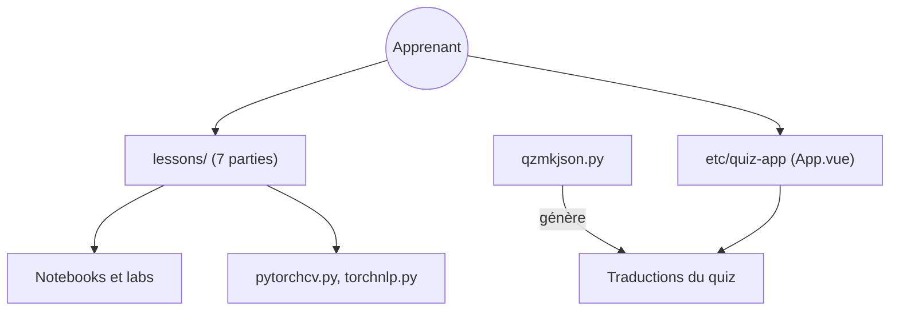

# microsoft/AI-For-Beginners

> Cours de 12 semaines et 24 leçons sur l'IA, avec notebooks et quiz, pour débutants.

## Le problème
Les débutants ne savent pas par où commencer entre IA symbolique, réseaux de neurones, vision et langage.

## Ce que ça fait vraiment
Un programme en sept parties : introduction, IA symbolique, réseaux de neurones, vision, traitement du langage, autres techniques (algorithmes génétiques, apprentissage par renforcement profond, multi-agents) et éthique. Chaque leçon propose des notebooks PyTorch ou TensorFlow, parfois un lab. Une application de quiz Vue.js est incluse.

## Comment c'est branché


## Essayer
```bash
git clone --filter=blob:none --sparse https://github.com/microsoft/AI-For-Beginners.git
cd AI-For-Beginners
git sparse-checkout set --no-cone '/*' '!translations' '!translated_images'
```

## Coût et pièges
Gratuit. Plus de 50 traductions alourdissent le clone : d'où le checkout partiel. Un environnement Python avec PyTorch ou TensorFlow est nécessaire pour les notebooks (non précisé).

## Ce que ce n'est pas
Pas un cours sur le ML classique, le cloud ni les LLM récents : le README renvoie ailleurs. Il avoue être en retard sur l'état de l'art.

## Alternatives
Aucune alternative nommée, hormis d'autres cursus Microsoft (Machine Learning for Beginners).

## Pour toi
À surveiller : trop élémentaire pour toi, mais utile pour former un collègue ou combler IA symbolique et algorithmes génétiques.

