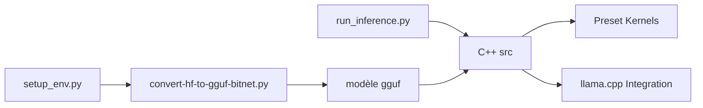

# microsoft/BitNet

> C++ inference engine for 1-bit LLMs and embeddings on CPU, for local inference.

## The problem
Running an LLM on CPU is slow and power-hungry at full precision.

## What it actually does
bitnet.cpp, built on llama.cpp, provides optimized kernels (I2_S, TL1, TL2) for ternary b1.58 models, on CPU and GPU. `setup_env.py` downloads and converts a Hugging Face model to GGUF, `run_inference.py` runs it. Official models: BitNet-b1.58-2B-4T, 0.6B and 270M embeddings. Announced speedups of 1.37× to 6.17× depending on the CPU.

## How it is wired


## Trying it
```bash
git clone --recursive https://github.com/microsoft/BitNet.git
pip install -r requirements.txt
huggingface-cli download microsoft/BitNet-b1.58-2B-4T-gguf --local-dir models/BitNet-b1.58-2B-4T
python setup_env.py -md models/BitNet-b1.58-2B-4T -q i2_s
python run_inference.py -m models/BitNet-b1.58-2B-4T/ggml-model-i2_s.gguf -p "You are a helpful assistant" -cnv
```

## Cost and gotchas
Requires building with clang ≥ 18 and cmake; on Windows, Visual Studio 2022. Only works with models trained in 1-bit, not with any quantized LLM.

## What it is not
Not a general replacement for llama.cpp; the catalog of compatible models is limited.

## Alternatives
None named as an alternative (llama.cpp is the base).

## For you
1-bit embeddings on CPU are interesting for lightweight RAG: worth watching.
