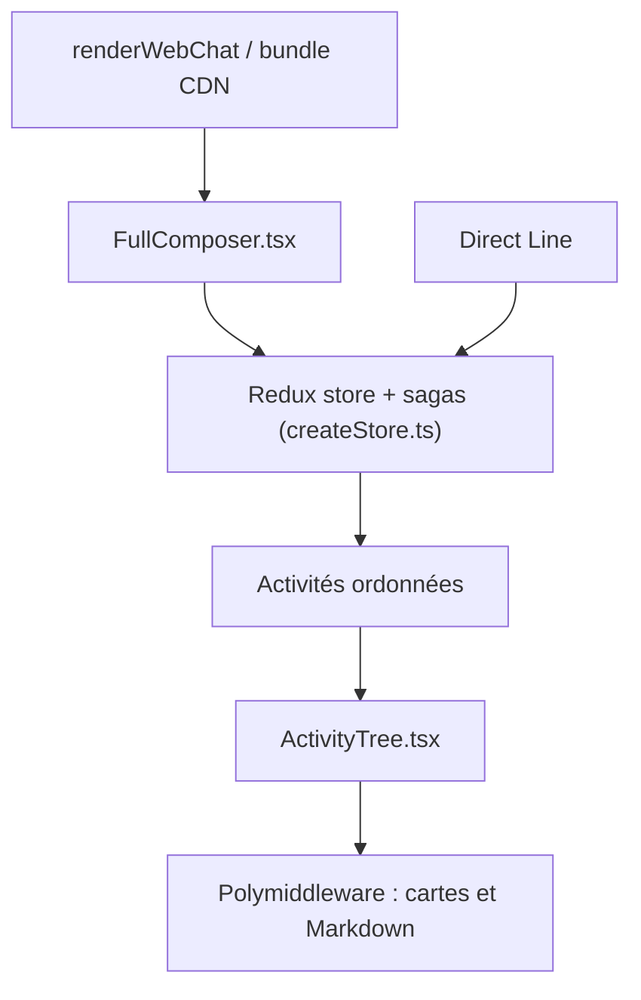

# microsoft/BotFramework-WebChat

> Customizable web chat component to display a Bot Framework v4 bot in a website.

## The problem
A Bot Framework bot deployed on Azure has no ready-made chat window that can be embedded in a web page, accessible and customizable.

## What it actually does
The component displays the conversation (text, rich cards, Adaptive Cards up to 1.6, sanitized Markdown, live streaming) and connects to the bot through Direct Line or Direct Line Speech. It integrates in JavaScript via a CDN bundle or in React with hooks and middlewares to replace the rendering. Voice goes through Azure Speech or the browser's Web Speech API. A Fluent theme is in an experimental phase.

## How it is wired


## Trying it
```bash
npm install botframework-webchat
npm install botframework-webchat@main
```

## Cost and gotchas
The library is free, but you need a bot on Azure Bot Service and a Direct Line secret, to be converted into a token on the server side rather than left in the client. The Azure cost is not detailed here.

## What it is not
Not a bot nor an AI SDK: only the interface. The Bot Framework SDK is archived (December 2025), not this component. Internet Explorer is no longer supported since 4.16.

## Alternatives
No alternative cited in the README.

## For you
Ignore unless you host bots on Azure Bot Service: it is an interface building block tied to that ecosystem, unrelated to models or MLOps.
