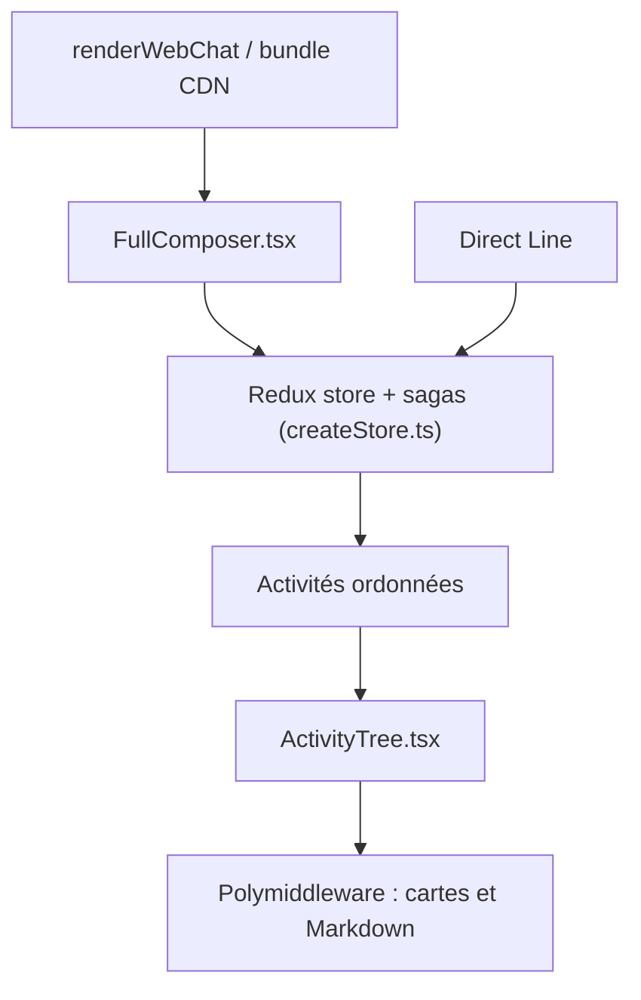

# microsoft/BotFramework-WebChat

> Composant de chat web, personnalisable, pour afficher dans un site un bot Bot Framework v4.

## Le problème
Un bot Bot Framework déployé sur Azure n'a pas de fenêtre de discussion prête à intégrer dans une page web, accessible et personnalisable.

## Ce que ça fait vraiment
Le composant affiche la conversation (texte, cartes riches, Adaptive Cards jusqu'à la 1.6, Markdown assaini, flux en direct) et se connecte au bot par Direct Line ou Direct Line Speech. Il s'intègre en JavaScript via un bundle CDN ou en React avec hooks et middlewares pour remplacer le rendu. La voix passe par Azure Speech ou l'API Web Speech du navigateur. Un thème Fluent est en phase expérimentale.

## Comment c'est branché


## Essayer
```bash
npm install botframework-webchat
npm install botframework-webchat@main
```

## Coût et pièges
La bibliothèque est gratuite, mais il faut un bot sur Azure Bot Service et un secret Direct Line, à convertir en jeton côté serveur plutôt que le laisser dans le client. Le coût Azure n'est pas détaillé ici.

## Ce que ce n'est pas
Ce n'est pas un bot ni un SDK d'IA : seulement l'interface. Le Bot Framework SDK est archivé (décembre 2025), pas ce composant. Internet Explorer n'est plus pris en charge depuis la 4.16.

## Alternatives
Aucune alternative citée dans le README.

## Pour toi
À ignorer sauf si tu héberges des bots sur Azure Bot Service : c'est une brique d'interface couplée à cet écosystème, sans lien avec les modèles ou le MLOps.

