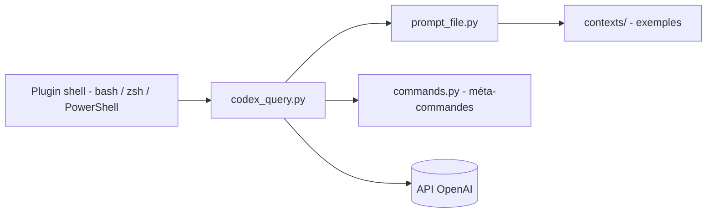

# microsoft/Codex-CLI

> 2022 Microsoft demo that translates sentences into shell commands via GPT-3 Codex.

## The problem
Writing an exact shell command requires knowing the syntax of PowerShell, Bash or zsh.

## What it actually does
You write a natural-language comment in the shell then press `Ctrl + G`: a plugin sends the line to the Python module `codex_query.py`, which builds a prompt with examples (files from the `contexts/` folder) and queries the OpenAI API. The command comes back into the terminal. A multi-turn mode keeps the history in `current_context.txt`. Meta-commands manage contexts and configuration.

## How it is wired

## Trying it
The README refers to per-shell installation instructions outside the README. Usage: write a comment starting with `#` then `Ctrl + G`. Settings: `# set engine cushman-codex`, `# set temperature 0.5`, `# set max_tokens 50`.

## Cost and gotchas
An OpenAI account, API key, organization ID and engine ID must be provided; each request is billed. The Codex engines of the time (`code-davinci-002`) may no longer be available. Last push in January 2024.

## What it is not
The repository presents itself as an example for the Build 2022 conference, not as a product. The generated commands may be wrong: do not run anything without understanding it.

## Alternatives
`zsh_codex` (cited as a source of inspiration), limited to zsh.

## For you
Ignore: an old demo depending on retired or paid models; the idea can be found elsewhere, but not this code.
