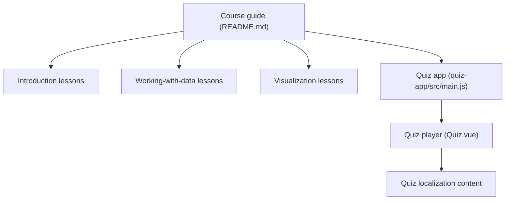

# microsoft/Data-Science-For-Beginners

> 10-week, 20-lesson data science curriculum with quizzes, exercises and solutions, for beginners.

## The problem
Beginners lack a structured path that mixes theory, practice and assessment.

## What it actually does
Twenty lessons in six blocks: introduction, working with data (SQL, NoSQL, Python/Pandas, preparation), visualization (Matplotlib), lifecycle, cloud (Azure ML) and real-world cases. Each lesson offers pre- and post-lesson quizzes, an assignment and a solution. A Vue quiz app (40 quizzes) is included, along with translations.

## How it is wired


## Trying it
```bash
docsify serve
```
Run this command at the root of your forked repository; it serves the docs locally on localhost:3000. Otherwise: Codespaces, VS Code container, or read the lessons directly.

## Cost and gotchas
Free. The cloud lessons assume an Azure account. Notebooks do not render in Docsify: you need a separate Python kernel.

## What it is not
Not an advanced course: no advanced machine learning or MLOps. The cloud lessons are Azure-oriented.

## Alternatives
No alternative named in the README; it points to other curricula from the same team (LangChain, generative AI).

## For you
Too elementary for an experienced data/AI profile, but useful to pass on to a beginner; keep an eye on it as a resource to recommend.
