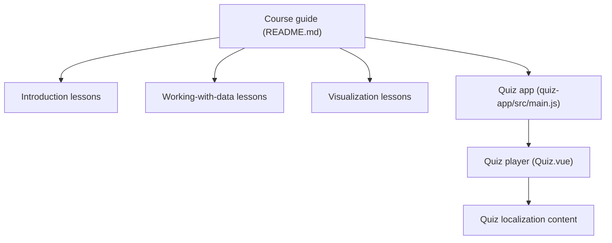

# microsoft/Data-Science-For-Beginners

> Cursus de 10 semaines et 20 leçons sur la data science, avec quiz, exercices et solutions, pour débutants.

## Le problème
Les débutants manquent d'un parcours structuré qui mêle théorie, pratique et évaluation.

## Ce que ça fait vraiment
Vingt leçons en six blocs : introduction, travail sur les données (SQL, NoSQL, Python/Pandas, préparation), visualisation (Matplotlib), cycle de vie, cloud (Azure ML) et cas réels. Chaque leçon propose quiz avant et après, devoir et solution. Une application de quiz Vue (40 quiz) est incluse, ainsi que des traductions.

## Comment c'est branché


## Essayer
```bash
docsify serve
```
Cette commande, à lancer à la racine du dépôt forké, sert la doc en local sur localhost:3000. Sinon : Codespaces, conteneur VS Code, ou lecture directe des leçons.

## Coût et pièges
Gratuit. Les leçons cloud supposent un compte Azure. Les notebooks ne s'affichent pas dans Docsify : il faut un noyau Python à part.

## Ce que ce n'est pas
Pas un cours avancé : on n'y trouve ni machine learning poussé ni MLOps. Les leçons cloud sont orientées Azure.

## Alternatives
Aucune alternative nommée dans le README ; il renvoie vers d'autres cursus de la même équipe (LangChain, IA générative).

## Pour toi
Trop élémentaire pour un profil data/IA confirmé, mais utile à transmettre à un débutant ; à surveiller comme ressource à recommander.

