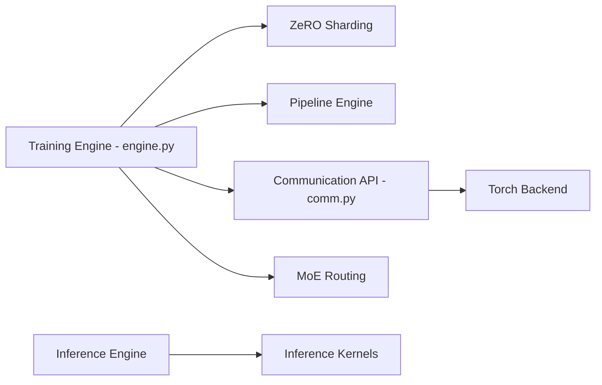

# microsoft/DeepSpeed

> Distributed training and inference library for very large PyTorch models, for ML engineers.

## The problem
Training a model with billions of parameters exceeds the memory of a single GPU and the network bandwidth.

## What it actually does
System optimizations: ZeRO and ZeRO-Infinity (optimizer state partitioning, CPU/NVMe offload), 3D parallelism, Ulysses (long sequences), MoE, compression/quantization, inference engines. Integrated with Accelerate, Lightning, MosaicML, Determined. The C++/CUDA extensions are compiled on the fly (JIT, ninja).

## How it is wired


## Trying it
```bash
pip install deepspeed
ds_report
```

## Cost and gotchas
PyTorch must be installed first. A CUDA/ROCm compiler (nvcc or hipcc) is required for the extensions. Windows: some features (AIO, GDS) are missing.

## What it is not
Not useful on a single small GPU or for light fine-tuning. It is not a complete training framework: it plugs into yours.

## Alternatives
No alternative named in the README.

## For you
Adopt it as soon as large-model training or memory offload comes into play; useless for models that fit on one card.
